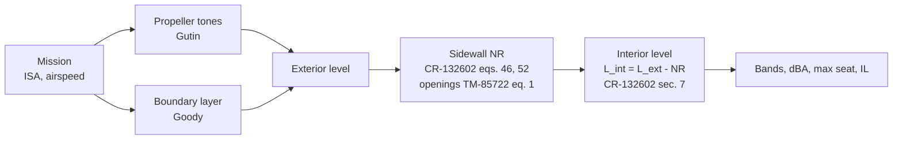

# Cabin_Noise: the paper pipeline

**Restructured 2026-11-02; audited the same day (AUDIT.md).** Every block follows a published low-fidelity method exactly and is verified against that paper's own equations. Nothing beyond the papers is in the pipeline.

**Sources:** `references/` (NASA NTRS, hashes in `references/SOURCES.md`) and `../PAIN_Program/references/`.

## 1. The chain

| Block | Method, exactly | Source | Verified by: case (Validation tab) or unit test (`tests/`) |
|---|---|---|---|
| Atmosphere, airspeed | ISA. Mission input: Mach, or KCAS converted with the subsonic pitot relations, q_c = p0 [(1 + 0.2 (V_c / a0)^2)^3.5 - 1], M = sqrt(5 [(q_c / p + 1)^(2/7) - 1]). Flight-test runners (CR-178004): TAS = IAS sqrt(rho0 / rho) | US Std. Atm. 1976; standard pitot-static relations | unit tests `test_isa_against_us_standard_atmosphere` (US Std. Atm. table), `test_sutherland_viscosity_table_value`, `test_tas_and_measured_temperature`, `test_calibrated_airspeed_to_mach` (sea level CAS = TAS; 250 KCAS at 25000 ft = 363 KTAS) |
| Propeller tones | Gutin: p_m = (mB Omega / 2 sqrt2 pi c r) abs(T cos(theta) - Q c / (Omega R_e^2)) J_mB(...), R_e = 0.8 R_t, at the fuselage point nearest the propeller; one propeller per side, sides in energy | Gutin 1936; NASA RP-1258 vol. 1 ch. 1 | case V0a: direct quadrature of the dipole integral (1e-12 dB); unit test `test_gutin_against_direct_time_domain_moving_force_far_field` (0.1 dB) |
| Boundary layer | Goody wall spectrum on a 1/7-power flat-plate layer; diffuse equivalent <p^2> = <p_wall^2> / 2 | Goody 2004; Schlichting; Waterhouse 1955, CR-3813 p. 23 | unit tests `test_goody_asymptotic_slopes_and_flat_plate_layer` (Goody's +2 / -5 slopes; delta and Cf of the 1/7-power law) and `test_waterhouse_wall_factor_and_diffuse_intensity` (Monte Carlo of the wall = 2 x diffuse factor). No V case: Goody gives no closed form to compare with |
| Wall transmission | random-incidence mass law, eq. (46) | NASA CR-132602 sec. 5.1 | case V1: eq. (46) = 0-90 deg integral of eq. (45) (1e-9) |
| Sidewall NR | non-resonant double wall, eq. (52): NR = 10 log[(1 + 4 alpha3 / (eps tau31))(1 + alpha5 / tau35) + alpha5 / tau31]; blanket mass on the trim (sec. 6.2); single wall: 10 log(1 + alpha5 / tau) | NASA CR-132602 sec. 5.2 | case V2: eq. (52) = numeric solution of the power balance eq. (47) (1e-14); case V2p: the report's Fig. 14 prediction (check failed, 3.3 dB); unit tests `test_pipeline_noise_reduction_is_eq52_and_the_single_wall_form`, `test_double_wall_limits` |
| Openings | area-weighted transmission; double window = one pane of the summed mass; areas given per side, scaled with the exposed area | NASA TM-85722 eq. (1), p. 17 | unit tests `test_openings_combine_by_area_as_tm85722_eq1` (eq. 1 written out), `test_openings_scale_with_the_exposed_area`. No V case: eq. 1 is an area average, so a case would repeat the unit test |
| Cabin | alpha5 S = A = sum S alpha (Sabine), or 0.161 V / T60 from measured T60 | Sabine; CR-132602 eq. (37) | unit tests `test_cabin_absorption_is_sabine` (sum S alpha by hand; measured-T60 path against 24 ln10 V / c T60), `test_sabine_constant`. No V case |
| Insertion loss | L_bare - L_treated = dTL + dABS | NASA TM-85722 eqs. (1)-(3) | case V3: within 0.28 dB (the "1 +" term of the single-wall form); unit tests `test_identical_configs_have_zero_il`, `test_heavier_trim_and_more_absorption_give_positive_il` |
| Seat spread | P-th percentile seat = room average + 10 log10(ln(1 / (1 - P))); P an input, default 95 % (+ 10 log10(ln 20) = 4.77 dB) | Schroeder 1962 | unit tests `test_seat_statistic_is_the_exponential_95th_percentile`, `test_seat_percentile_is_the_exponential_quantile` (80-99 %; quantiles of an exponential sample), `test_pipeline_uses_the_seat_percentile`. No V case |
| Weighting | IEC A / C | IEC 61672-1 | unit test `test_weighting_against_iec_61672_table` (A and C at 31.5 Hz-8 kHz, 0.1 dB). No V case |

**Cases and unit tests.** A V case is a check shown on the Validation tab, with a figure. A block whose paper gives nothing to compare a curve with (a table, a constant, an area average, a statistic) is verified by unit tests instead. They run with `pytest` (`tests/test_sources.py`, `test_methods.py`, `test_pipeline.py`, `test_inputs.py`) and are as binding: a failing test blocks a change. Each unit test compares the code with a published table, an independent derivation or a hand calculation, never with itself. Measured-data validation of the blocks together is V4-V7 (sec. 4).

The end-to-end hand check (`tests/test_end_to_end.py`) recomputes a tone and a band of the default case from these formulas, written out independently; the tool agrees within 0.01-0.05 dB.

## 2. Things found in the sources

- **CR-132602 eq. (53) misprint.** It shows 2/eps; eq. (52) and the report's power balance give 4/eps. The numeric solution of eq. (47) confirms 4/eps, which is used.
- **CR-132602's own limit.** Sec. 6.2 and 8(d) say the non-resonant model is invalid well below about half the ring frequency, where panel stiffness dominates. Propeller tones on small aircraft lie there.
- **CR-132602 Fig. 14 (case V2p, 2026-11-02).** This is the paper's own printed NR prediction. Built from the inputs the report states, the code's single wall comes out 2.1-3.3 dB low, with the right shape.
  - The report says it used eq. (53), whose area ratio S5/S2 it does not give. A post-hoc S5/S2 = 2 matches within 0.3 dB. The pipeline itself carries the ratio through A / S.
  - The double-wall curve also needs the unstated blanket mass, so it cannot settle 2/eps against 4/eps.
- **Gutin is a far-field formula.** Applying it at the fuselage, which is in the near field, is the classic low-fidelity practice and is its known limit.

## 3. What was removed (2026-11-02)

These were removed because they are not in the papers. Their code and validation records are in git, up to commit 1c2c8fe:
- the plane-wave transfer-matrix sidewall and its Delany-Bazley, limp and table blanket models;
- the stiffened-bay stiffness;
- the blade-geometry (BEMT) source and the moving-force near-field source;
- cylinder scattering;
- the patch grid and measured-level anchoring;
- box-mode seat shapes and the twin coherent synchrophase sum.

Retired cases: V0b, V0c, V4c, V4d, V5d.

## 4. Validation of the paper pipeline (2026-11-02)

Cases are defined in commit 93bbeb9, before the runs. The data were seen with the retired pipeline, so these runs are not blind; no parameter is chosen from the data. Criteria are unchanged (low-fi policy: at least 75 % of points within +-6 dB; V4a: max error 3 dB).

| Case | Data | Result |
|---|---|---|
| V5b | CR-178004 exterior boundary-layer bands | **met**, 82 % |
| V6 | CR-178004 fiberglass insertion loss | not met, 72 % (mean +1.4 dB) |
| V5 | CR-178004 exterior tones (Gutin + 6 dB flush doubling) | not met, 64 % (mean -3.3 dB) |
| V4 | TM-85722 Fig. 18, lab TL of the prop-plane treated panel (run 2026-11-03) | not met, 5/11 bands; within 3 dB to 250 Hz, 6-13 dB low above 315 Hz (a single limp wall has no double-wall rise) |
| V4b | CR-3813 trimmed cylinder reverberant NR | not met, 26 % |
| V5c | Report 996 static tones at d/D = 0.083 (Gutin) | not met, 29 %; Gutin's far-field form at the blade tip |
| V4a | TP-1964 bare cylinder reverberant NR | not met, max 16.5 dB |
| V7 | CR-178004 cabin tones from the measured exterior | not met, 1 %, +17.9 dB; mass-law wall far below 0.5 f_r (the paper's stated limit) |

The misses are where the papers' own stated limits put them:
- at low frequency, below about 0.5 f_r, for tones through a real fuselage;
- in the near field for Gutin.

## 5. Inputs and fixed constants (2026-11-03)

**Inputs.** Every input is a field of the project, and all of them can be edited in the GUI:
- Mission, Propeller, Fuselage, Sidewall, Openings and Cabin tabs;
- the Analysis tab: band range and the max-seat percentile.

The default example's values are all in `cabin_noise/data/default_project.json`; none is set in code. Two tests enforce this (`tests/test_inputs.py`):
- every field must appear in that file;
- every field must have a GUI editor.

**Fixed constants.** These belong to the published equations. They are not inputs, so they cannot be changed by accident:

| Constant | Value | Where | Source |
|---|---|---|---|
| Diffuse-field wall factor | wall p^2 = 2 x diffuse p^2 (3.0 dB) | `pipeline.WATERHOUSE_DB` | Waterhouse 1955; CR-3813 p. 23 |
| Flat-plate turbulent boundary layer | delta = 0.37 x Re^-0.2, Cf = 0.0592 Re^-0.2 | `source_tbl.boundary_layer` | 1/7-power law, Schlichting |
| Goody spectrum | 3.0, 0.75, 0.5, 3.7, 1.1, -0.57, 7 | `source_tbl.goody_phi` | Goody 2004 |
| Gutin | 2 sqrt2 pi, Bessel J_mB | `source_tonal.gutin_rms` | RP-1258 ch. 1 |
| Mass law | random incidence 0-90 deg, eq. (46) | `sea.tau_mass_law_diffuse` | CR-132602 |
| Cavity epsilon | pi below c / 2L, 4 above | `sea` | CR-132602 eqs. (51)-(52) |
| Sabine | 0.161 V / A | `cabin.t60` | Sabine |
| Schroeder frequency | 2000 sqrt(T60 / V) | `cabin.schroeder_frequency` | Schroeder 1962 |
| Seat statistic | 10 log10(ln(1 / (1 - P))) | `cabin.seat_stat_db` | Schroeder 1962 (P is an input) |
| ISA, Sutherland | US Std. Atm. 1976 | `atmosphere` | |
| A / C weighting | IEC 61672-1 | `weighting` | |
| Reference pressure | 20 uPa | `weighting.P_REF` | |
