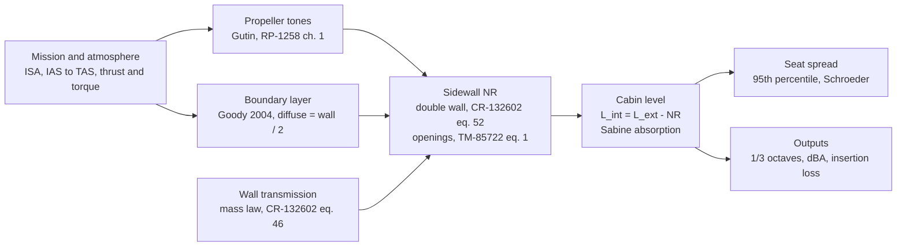
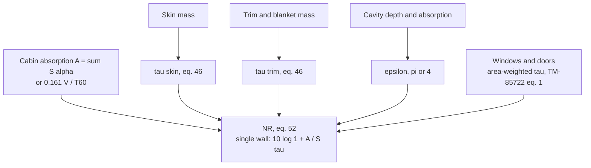
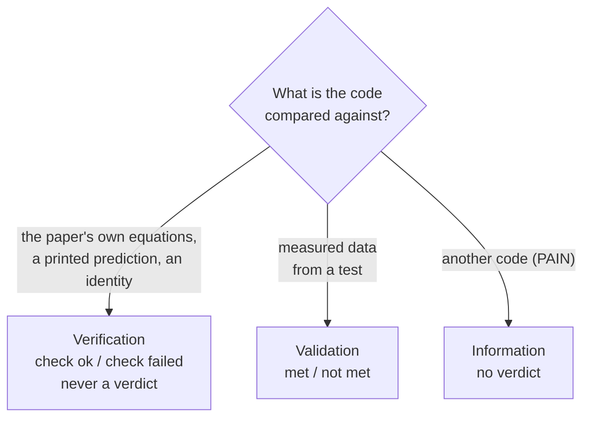
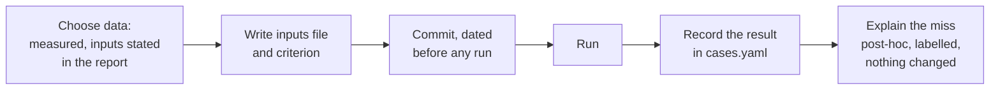
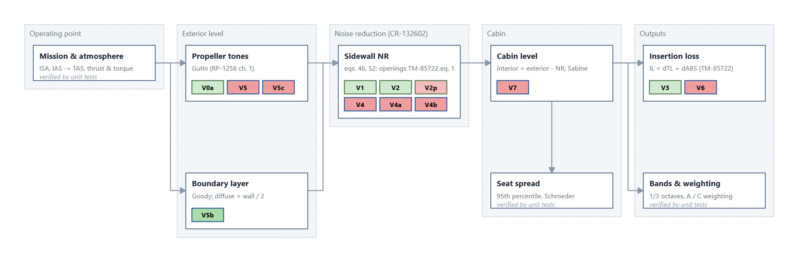
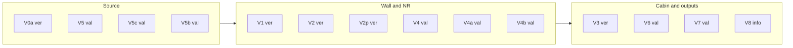

# Cabin_Noise: the validation cases and why they were chosen

**Date:** 2026-11-03. **Cases:** `cabin_noise/data/validation/cases.yaml`. **Figures:** `docs/figures/`, regenerated by `scripts/make_doc_figures.py`. They are the same plots the GUI's Validation tab draws.

This document explains:
- what each case checks;
- which block of the pipeline it tests;
- why that data set was chosen;
- what the result says.

METHOD.md gives the equations, VERIFICATION.md the unit-test checks, and `cases.yaml` the exact criteria, dates and recorded results.

## 1. The pipeline

Every block follows one published low-fidelity paper:



The noise reduction (NR) block carries most of the physics. Its inputs are:



## 2. Two kinds of case



**Verification** asks whether the code does exactly what the paper says. It is checked against:
- the paper's equation solved another way;
- a printed worked example.

**Validation** asks how close the paper's method comes to a measurement. A miss is an acceptable result for a low-fidelity tool. It is recorded with its cause, and never tuned away.

Every case follows the same order:



**The criterion for validation cases:** at least 75 % of the points in range must lie within ±6 dB. This is the low-fi policy of 2026-11-02, written for design trades rather than point accuracy. V4a keeps its original max-error criterion of 3 dB.

**Why a data set qualifies:**
1. **Measured, not predicted.** A printed prediction can only be a verification target, as V2p is.
2. **Inputs stated.** Every input the method needs is printed in the report, or is a documented assumption committed before the run.
3. **It isolates a block.** The best case tests one block with the others removed: a lab panel tests the wall alone, and a measured exterior removes the source. End-to-end cases come last.
4. **Independent.** It is not the data a model change was motivated by. For example, the repeat flights of CR-178004 are not an independent check of flight 3.

## 3. Which case tests which block





## 4. Verification cases

| Case | Checks | Why | Result | Figure |
|---|---|---|---|---|
| V0a | Gutin's closed form against direct quadrature of the rotating-dipole integral it is derived from | The closed form (Bessel function) is where an implementation slip would hide | check ok, 2e-12 dB | [V0a](docs/figures/V0a.png) |
| V1 | CR-132602 eq. 46 against the 0-90 deg integral of eq. 45 | Eq. 46 is the closed form of that integral; every wall in the tool uses it | check ok, 9e-10 dB | [V1](docs/figures/V1.png) |
| V2 | CR-132602 eq. 52 against a numeric solution of the power balance eq. 47 | Eq. 52 is derived from eq. 47. This check also settles the eq. 53 misprint (2/eps against 4/eps) | check ok, 7e-15 dB | [V2](docs/figures/V2.png) |
| V3 | The pipeline's insertion loss against TM-85722's IL = dTL + dABS | It checks that openings and absorption are wired the way TM-85722 splits them | check ok, 0.28 dB (the "1 +" term) | [V3](docs/figures/V3.png) |
| V2p | CR-132602 Fig. 14 reproduced from the report's stated inputs | It is the paper's only printed worked example of the NR method: the whole NR block, end to end | **check failed**, 3.3 dB | [V2p](docs/figures/V2p.png) |

**V2p in more detail.** The single wall comes out 2.1-3.3 dB below Fig. 14, but with the right shape.
- The report computed Fig. 14 with eq. 53, which keeps the area ratio S5/S2. It never states that ratio.
- A post-hoc S5/S2 = 2 closes the gap to within 0.3 dB. That makes the failure a missing input, not a code error, but the recorded result stays "failed".
- The double-wall curve needs the blanket mass, which is not printed, so it is drawn as information only.

## 5. Validation cases (measured data)

### Wall and NR

**V4: lab TL of the prop-plane treated panel.** Not met, 5/11 bands. [Figure](docs/figures/V4.png)
- **Data:** NASA TM-85722 Fig. 18 and Table I, a Commander 695A sidewall panel measured in the lab.
- **Why chosen:** the lab test removes the source and the cabin, so the wall formula is tested alone. The prop-plane layup is the only one whose mass Table I fixes unambiguously.
- **Result:** within 3 dB up to 250 Hz. From 315 Hz up it is 6-13 dB low: the septa and barrier on fiberglass act as a second wall, which a single limp wall cannot show.

**V4a: bare cylinder, reverberant NR.** Not met, max 16.5 dB. [Figure](docs/figures/V4a.png)
- **Data:** NASA TP-1964 Fig. 8.
- **Why chosen:** it is the simplest structure with measured NR. It has a single wall, no trim, and a measured T60, so it tests the single-wall form with the room term.
- **Result:** below about 1 kHz the mass law gives 10-45 dB less NR than measured: the curved shell is stiffness-controlled below its ring frequency (3.3 kHz), which a flat limp wall cannot show. Above 2 kHz the code's NR keeps rising while the measured NR dips toward the ring frequency.

**V4b: stiffened, trimmed cylinder, reverberant NR.** Not met, 5/19 bands. [Figure](docs/figures/V4b.png)
- **Data:** NASA CR-3813 Fig. E-22.
- **Why chosen:** it tests the double wall (eq. 52) with trim, and every input is printed in CR-3813. PAIN predicted the same case, so the two tools can be compared.
- **Result:** 9-17 dB low at 63-160 Hz (the same stiffness-controlled shell as V4a), within ±6 dB at 200-630 Hz, and 14-22 dB high above 800 Hz, where the double wall rises faster than the measurement. CR-3813 reports that PAIN also overpredicted this case at high frequency.

### Source

**V5: flight exterior tones at the fuselage.** Not met, 65/101. [Figure](docs/figures/V5.png)
- **Data:** NASA CR-178004 App. A, flight 3.
- **Why chosen:** it is the measured source level on the same aircraft as V6 and V7, so the source can be judged before the cabin.
- **Result:** mean -3.3 dB. BPF1 is close, and BPF2 and BPF3 fall 6-13 dB low. Gutin is a far-field formula, and the microphone is near the tip.

**V5c: static near-field tones.** Not met, 15/52. [Figure](docs/figures/V5c.png)
- **Data:** NACA Report 996 Figs. 12 and 14.
- **Why chosen:** it is a different propeller, static and in the lab, so it checks Gutin independently of the flight data.
- **Result:** errors up to 47 dB. The points are at d/D = 0.083, deep in the near field where Gutin's far-field form fails.

**V5b: boundary-layer pressure, 800 Hz - 5 kHz.** **Met**, 265/323. [Figure](docs/figures/V5b.png)
- **Data:** NASA CR-178004 App. D, flight 3.
- **Why chosen:** above 800 Hz the report attributes the exterior level to the boundary layer, which isolates Goody's spectrum.
- **Result:** mean +2.7 dB.

### Cabin and outputs

**V6: fiberglass insertion loss in flight.** Not met, 372/519 (72 %). [Figure](docs/figures/V6.png)
- **Data:** NASA CR-178004 App. J, flights 3 and 4.
- **Why chosen:** relative trades are the tool's intended use. The insertion loss cancels most of the absolute source error.
- **Result:** close to the criterion (75 % needed). The largest misses (up to +22 dB) are bands where the measured IL is near zero or negative, which a passive treatment model cannot give; the report cites structure-borne components there.

**V7: cabin tones, driven by the measured exterior.** Not met, 1/108. [Figure](docs/figures/V7.png)
- **Data:** NASA CR-178004 App. B, flight 3.
- **Why chosen:** the exterior is measured, not predicted, so the case tests NR and cabin in flight without the source error.
- **Result:** mean +17.9 dB. The blade passage frequency (78 Hz) lies far below half the fuselage's ring frequency, where CR-132602 itself says its mass-law wall is not valid.

### Information

**V8: cross-check against PAIN on the same cases.** No verdict.
- **Data:** PAIN_Program.
- **Why chosen:** to document where the low-fi tool and PAIN diverge.
- **Status:** not run yet (Goody-to-PAIN is parked).

**Summary:** 1 of 8 validation cases met. Every miss lies where its paper's own stated limit puts it:
- below about half the ring frequency for the mass-law wall (V4a, V4b, V7);
- the double-wall rise, missing from a single limp wall (V4) and too strong in eq. 52 at high frequency (V4b);
- the near field for Gutin (V5, V5c).

The tool's use is therefore relative trades at mid and high frequency, not absolute tone levels at the blade passage frequency.

## 6. Data considered and not used

| Data | Why not used |
|---|---|
| TM-85722 Fig. 18, bare-panel curve | It is a calculation, not a measurement. |
| TM-85722 Fig. 18, roof and aft-sidewall layups | Fig. 17 cannot be read for which septa they carry, so their mass is not fixed. They are digitized in `V4.csv` but not compared. |
| CR-132602 Fig. 14 | It is a prediction. It is used as verification (V2p), not validation. |
| CR-178004 flights 1, 2 and 4 (App. A) | Repeat flights of flight 3's conditions, so not an independent check. Flight 4 is used only as V6's treated case. |
| CR-3813 Fig. E-16 (T1/T2 interior levels) | It needs the measured exterior field as a source override, and the trim inputs are incomplete. |
| TP-2444 Figs. 17, 19 | The analysis bandwidth is not stated, and the trim inputs are incomplete. |
| CR-172428 App. B | It holds PAIN's predictions, not measurements, so it can only serve V8. |
| CR-172490 Fig. 15 | Sharp's double-panel prediction: another method, so verification at most. |

**Retired cases.** V0b, V0c, V4c, V4d and V5d tested models removed in the 2026-11-02 restructure (scattering, box-mode seats, stiffened bays, limp blankets, blade-geometry source). Their records are in git up to commit 1c2c8fe; see METHOD.md sec. 3.

## 7. Regenerating the figures

```bash
.venv/Scripts/python scripts/make_doc_figures.py
```

The script runs every case, which takes a few minutes, and saves one PNG per case that has a curve (all but V8) plus the map to `docs/figures/`. Each case figure has three panels:
- code (line) against reference (markers), with the acceptance band shaded;
- the error, with ±target;
- predicted against reference, on a 1:1 line.

Each panel has a legend naming its curves (code, the reference and its source, the acceptance band, the target lines, the 1:1 line, and any information curves). The caption below them gives the statistics over the points the verdict counts.
