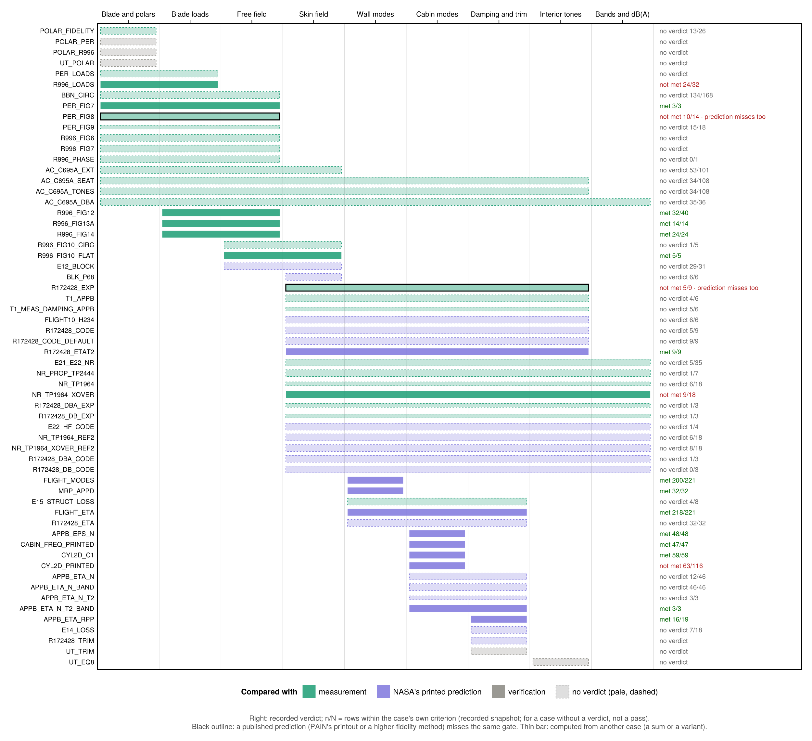

# Cases without a verdict (not on the coverage chart)

Generated by `scripts/run/write_case_error_summary.jl` from the snapshot `validation_reports/case_error_summary.csv` (latest run 2026-11-12); do not edit by hand. The coverage chart (`VALIDATION.md` and the GUI's Coverage tab) shows only the cases with a verdict (author 2026-10-29; the block map was retired in Phase 147, 2026-11-10). The cases below still run, in the GUI's Validation tab and in the tests; their records and criteria are in `VALIDATION_GUIDELINE.md` and the records in `CASE_RECORDS.md`. A recorded outcome listed here is not a pass.

Every case, with and without a verdict, on the program chain (pale dashed bars: no verdict; Phase 134):

## Diagnostic re-runs (16)

| Case | Chain span | Why it has no verdict | Recorded result |
|---|---|---|---|
| `PER_FIG9` Pereira Fig. 9 harmonics — loads scaled to measured thrust and torque | Blade and polars → Free field | the same measured values as PER_FIG8 at its three angles (within 0.15 dB): a row of PER_FIG8 | 15/18 rows within the band (not a pass); no verdict · max \|err\| 3.7 dB · med 0.35 dB |
| `E12_BLOCK` Fig. E-12 blocked SPL | Free field → Skin field | runs the R1 blocking, not the shipped R2, against a hand-read curve whose spread (2.91 dB) is near its tolerance | 29/31 rows within the band (not a pass); no verdict · max \|err\| 4.3 dB · med 1.1 dB |
| `APPB_ETA_N` Cabin-mode η_n vs NASA's App. B printout (87b; CR-3813 printed damping form) | Cabin modes → Damping and trim | runs CR-3813's printed damping form, not the shipped default; APPB_ETA_N_BAND sets the shipped rule against the same printout (post-hoc), APPB_ETA_N_T2_BAND tests it held out (Phase 136a, 136b) | 12/46 rows within the band (not a pass); no verdict · max \|err\| 175.3 % · med 4.7 % |
| `APPB_ETA_N_T2` Cabin-mode η_n at η_T = 2.0 vs CR-172428 p. 85 (94b) | Cabin modes → Damping and trim | η_n with the trim at the mode frequency (the Phase 93 form); APPB_ETA_N_T2_BAND carries the shipped rule | 3/3 rows within the band (not a pass); no verdict · max \|err\| 2.8 % · med 2.2 % |
| `APPB_ETA_N_BAND` Cabin-mode η_n by the band-centre rule vs App. B (96a, post-hoc) | Cabin modes → Damping and trim | sets the default η_n rule against the App. B values it was read from, post-hoc (Phase 96a) | 46/46 rows within the band (not a pass); no verdict · max \|err\| 0.0099 loss factor · med 0.00026 loss factor |
| `R172428_CODE` CR-172428 reproduction: NASA's inputs vs NASA's printed predictions (44d; CR-3813 printed form) | Skin field → Interior tones | runs CR-3813's printed program form, not the shipped default; R172428_CODE_DEFAULT runs the shipped form on the same printout (post-hoc), R172428_ETAT2 tests it held out (Phase 136a, 136b) | 5/9 rows within the band (not a pass); no verdict · max \|err\| 13.2 dB · med 2.6 dB |
| `R172428_DBA_CODE` CR-172428 tonal dB(A): NASA's inputs vs NASA's printed predictions (124; CR-3813 printed form) | Skin field → Bands and dB(A) | runs CR-3813's printed program form, not the shipped default; the shipped form on the same tones is R172428_CODE_DEFAULT; no separate test of the total (ISSUE-034; Phase 136a, 136b) | 1/3 rows within the band (not a pass); no verdict · max \|err\| 12.3 dB(A) · med 4.0 dB(A) |
| `R172428_DB_CODE` CR-172428 tonal dB (unweighted): NASA's inputs vs NASA's printed predictions (124; CR-3813 printed form) | Skin field → Bands and dB(A) | runs CR-3813's printed program form, not the shipped default; the shipped form on the same tones is R172428_CODE_DEFAULT; no separate test of the total (ISSUE-034; Phase 136a, 136b) | 0/3 rows within the band (not a pass); no verdict · max \|err\| 13.0 dB · med 4.7 dB |
| `R172428_CODE_DEFAULT` CR-172428 reproduction with the code as it ships (96d, post-hoc) | Skin field → Interior tones | re-runs R172428_CODE with the code as it ships, post-hoc (Phase 96d) | 9/9 rows within the band (not a pass); no verdict · max \|err\| 1.9 dB · med 0.18 dB |
| `FLIGHT10_H234` CR-172428 flight run 10, H2–H4: as shipped and trim per band vs PAIN (102) | Skin field → Interior tones | sets the code as it ships and the trim per band against PAIN's printed run 10 levels (Phase 102) | 6/6 rows within the band (not a pass); no verdict · max \|err\| 2.4 dB · med 1.8 dB |
| `E21_E22_NR` Figs. E-21 / E-22 NR | Skin field → Bands and dB(A) | compared with NASA's program before its corrections, and with measurement above the trim model's stated range | 5/35 rows within the band (not a pass); no verdict · max \|err\| 60.2 dB · med 17.7 dB |
| `T1_APPB` T1 on CR-172428 App. B's printed field (119) | Skin field → Interior tones | the measurement and field of R172428_EXP's 4000 rpm points with T1's gate: a row of that case | 4/6 rows within the band (not a pass); no verdict · max \|err\| 9.5 dB · med 2.1 dB |
| `T1_MEAS_DAMPING_APPB` T1 with measured damping on App. B's printed field (119) | Skin field → Interior tones | re-runs T1_APPB with measured damping in place of the tool's damping model | 5/6 rows within the band (not a pass); no verdict · max \|err\| 11.1 dB · med 1.7 dB |
| `NR_TP1964` TP-1964 bare-cylinder NR vs measured (43d) | Skin field → Bands and dB(A) | runs without the Eq. (18)/(19) changeover the tool uses; NR_TP1964_XOVER carries the verdict | 6/18 rows within the band (not a pass); no verdict · max \|err\| 16.5 dB · med 7.8 dB |
| `R172428_DBA_EXP` CR-172428 tonal dB(A) vs measured space averages (124) | Skin field → Bands and dB(A) | the dB(A) sum of R172428_EXP's tones: a row of that case, not a case of its own | 1/3 rows within the band (not a pass); no verdict · max \|err\| 6.5 dB(A) · med 4.7 dB(A) |
| `R172428_DB_EXP` CR-172428 tonal dB (unweighted) vs measured space averages (124) | Skin field → Bands and dB(A) | the dB sum of R172428_EXP's tones: a row of that case, not a case of its own | 1/3 rows within the band (not a pass); no verdict · max \|err\| 12.1 dB · med 8.2 dB |

## Information and verification under the meaningfulness rule (2)

| Case | Chain span | Why it has no verdict | Recorded result |
|---|---|---|---|
| `POLAR_FIDELITY` Section polars: XFOIL vs NACA TN 1546 measured c_l (67a) | Blade and polars → Blade and polars | it tests the section data that the Report 996 cases are fed, an input rather than the tool | 13/26 rows within the band (not a pass); no verdict · max \|err\| 0.19 · med 0.049 |
| `BLK_P68` Blocking Eq. (43) vs printed p.68 values | Skin field → Skin field | Eq. (43) against its own printed narrative (CR-172428 p. 68): a unit check of the equation (Phase 144d) | 6/6 rows within the band (not a pass); no verdict · max \|err\| 0.056 dB · med 0.0049 dB |

## Inputs not printed or measured (input-completeness rule, Phase 118) (11)

| Case | Chain span | Why it has no verdict | Recorded result |
|---|---|---|---|
| `BBN_CIRC` BBN circumferential phase | Blade and polars → Free field | inputs incomplete: the Aero Commander blade geometry is assumed | 134/168 rows within the band (not a pass); no verdict · max \|err\| 65.9 deg · med 14.4 deg |
| `R996_PHASE` Report 996 page-12 phase | Blade and polars → Free field | inputs incomplete: Report 996 does not state the two stations its one measured phase lies between | 0/1 rows within the band (not a pass); no verdict · max \|err\| 42.2 deg · med 42.2 deg |
| `E14_LOSS` Fig. E-14 loss factor | Damping and trim → Damping and trim | inputs incomplete: the side the facing sits on and the end-plate backing are not printed, and the compared loss factor moves with them by up to 8.5 % and 43 % (tolerance 25 %; ISSUE-037, 2026-11-12) | 7/18 rows within the band (not a pass); no verdict · max \|err\| 128.9 % · med 39.3 % |
| `NR_TP1964_XOVER_REF2` TP-1964 NR with changeover vs NASA ref. 2 (45b) | Skin field → Bands and dB(A) | inputs incomplete: NASA's ref. 2 curve is CR-159363 Fig. 34, whose mode spacing, radiation damping and excluded (1,1) mode were chosen against the measurement and are not printed (Phase 138b) | 8/18 rows within the band (not a pass); no verdict · max \|err\| 10.4 dB · med 3.9 dB |
| `E22_HF_CODE` High-frequency NR, this code vs NASA's E-22 prediction (61d) | Skin field → Bands and dB(A) | inputs incomplete: NASA's 1983 high-frequency routine, whose output it is compared with, is not printed | 1/4 rows within the band (not a pass); no verdict · max \|err\| 9.5 dB · med 6.7 dB |
| `NR_TP1964_REF2` TP-1964 bare-cylinder NR vs NASA pred. (43d) | Skin field → Bands and dB(A) | inputs incomplete: NASA's ref. 2 curve is CR-159363 Fig. 34, whose mode spacing, radiation damping and excluded (1,1) mode were chosen against the measurement and are not printed (Phase 138b) | 6/18 rows within the band (not a pass); no verdict · max \|err\| 16.3 dB · med 4.5 dB |
| `NR_PROP_TP2444` TP-2444 model 2: measured propeller-noise NR vs model (47c) | Skin field → Bands and dB(A) | inputs incomplete: run on CR-172428's trim, whose fiberglass weight does not match the lining TP-2444 prints (Phase 137a′) | 1/7 rows within the band (not a pass); no verdict · max \|err\| 23.4 dB · med 18.2 dB |
| `AC_C695A_DBA` Commander 695A cabin dB(A) vs CR-178004 flight 3 (121) | Blade and polars → Bands and dB(A) | inputs incomplete: the 695A blade, cabin cross-section and stiffener sections are not printed (assumed) | 35/36 rows within the band (not a pass); no verdict · max \|err\| 3.6 dB · med 0.69 dB |
| `AC_C695A_TONES` Commander 695A cabin tones vs CR-178004 App. B (122) | Blade and polars → Interior tones | inputs incomplete: the 695A blade, cabin cross-section and stiffener sections are not printed (assumed) | 34/108 rows within the band (not a pass); no verdict · max \|err\| 20.8 dB · med 5.9 dB |
| `AC_C695A_EXT` Commander 695A exterior tones vs CR-178004 App. A (123) | Blade and polars → Skin field | inputs incomplete: the 695A blade is not printed (assumed) | 53/101 rows within the band (not a pass); no verdict · max \|err\| 8.8 dB · med 4.0 dB |
| `AC_C695A_SEAT` Commander 695A cabin tones at the mic seats vs CR-178004 App. B (125) | Blade and polars → Interior tones | inputs incomplete: the 695A blade, cabin cross-section and stiffener sections are not printed (assumed) | 34/108 rows within the band (not a pass); no verdict · max \|err\| 24.8 dB · med 7.0 dB |

## No criterion (displays and records) (8)

| Case | Chain span | Why it has no verdict | Recorded result |
|---|---|---|---|
| `POLAR_R996` Report 996 polars (display) | Blade and polars → Blade and polars | the case registers no pass criterion | no criterion |
| `POLAR_PER` Pereira polars (display) | Blade and polars → Blade and polars | the case registers no pass criterion | no criterion |
| `PER_LOADS` Pereira Table 3 loads | Blade and polars → Blade loads | the case registers no pass criterion | no criterion |
| `R996_FIG6` Report 996 Fig. 6 | Blade and polars → Free field | the case registers no pass criterion | no criterion |
| `R996_FIG7` Report 996 Fig. 7 | Blade and polars → Free field | the case registers no pass criterion | no criterion |
| `R996_FIG10_CIRC` Eq. (43) blocking vs Report 996 Fig. 10 circular wall, information (90c) | Free field → Skin field | the case registers no pass criterion | 1/5 rows within the band (not a pass); no verdict · max \|err\| 5.3 dB · med 1.8 dB |
| `E15_STRUCT_LOSS` Fig. E-15 η_r′ (struct. loss) | Wall modes → Damping and trim | the case registers no pass criterion | 4/8 rows within the band (not a pass); no verdict · max \|err\| 150.0 % · med 57.5 % |
| `R172428_TRIM` CR-172428 trim factor / admittance vs App. B (diagnostic) | Damping and trim → Damping and trim | the case registers no pass criterion | no criterion |

## Not in the snapshot (3)

| Case | Chain span | Why it has no verdict | Recorded result |
|---|---|---|---|
| `UT_POLAR` Polar loader (Pkg.test) | Blade and polars → Blade and polars | Pkg.test only |  |
| `UT_TRIM` Trim / loss (Pkg.test) | Damping and trim → Damping and trim | Pkg.test only |  |
| `UT_EQ8` Eq. (8) coupling + HF tones (Pkg.test) | Interior tones → Interior tones | Pkg.test only |  |

## Reached after a change located with the case's own data (independence rule, 2026-11-09) (1)

| Case | Chain span | Why it has no verdict | Recorded result |
|---|---|---|---|
| `R172428_ETA` CR-172428 structural loss factors η_r′ vs App. B (44c/44d) | Wall modes → Damping and trim | post-hoc: met 32/32 only after the ISSUE-032 fix (2026-11-12), whose place was found by comparing with App. B, this case's own data; first run not met 17/32 | 32/32 rows within the band (not a pass); no verdict · 32/32 within criterion · count only |

