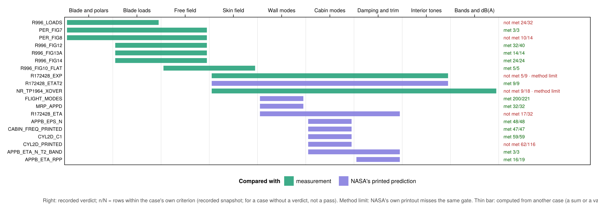

# PAIN validation status

Generated; do not edit by hand. The criteria are in [`VALIDATION_GUIDELINE.md`](VALIDATION_GUIDELINE.md), the case records in [`CASE_RECORDS.md`](CASE_RECORDS.md), the cases without a verdict in [`NO_VERDICT_CASES.md`](NO_VERDICT_CASES.md).

<!-- scoreboard:start (generated by scripts/run/write_case_error_summary.jl; do not edit by hand) -->
## 0. Validation status at a glance

Snapshot of the recorded case results (`docs/validation_reports/case_error_summary.csv`, latest run 2026-11-12). 19 cases carry a verdict: 13 met, 6 not met. A case carries one only if it runs the shipped code, every input it compares on is printed or measured, and it is compared with a measurement or with NASA's program output (author 2026-11-09). The 83 cases without one are listed in `NO_VERDICT_CASES.md`. **Points** = table rows within the case's criterion / all rows. Regenerated by `scripts/run/write_case_error_summary.jl`; the criteria and records are in §2.13.

### Chain coverage (cases with a verdict)

Each bar spans the part of the program chain a case runs: from the stage its given input enters at to the stage of the quantity it compares (`**Chain span:**`, §2.13); its colour is what it is compared with (`**Compared with:**`). The cases without a verdict are drawn in `NO_VERDICT_CASES.md`; the GUI's Coverage tab shows both.

**19 cases with a verdict, 19 independent comparisons** (the sums and variants of a case carry no verdict since Phase 135f); met 13, not met 6. 7 families group the cases that share one run or one printout (Phase 145d; GUI Coverage tab, "Order by source figure").

| Chain span | Compared with | Case | Verdict | Points |
|---|---|---|---|---|
| Blade and polars → Blade loads | measurement | Propeller thrust and power coefficients against measurement (NACA RM L8H25a) (`R996_LOADS`) | not met | 24/32 |
| Blade and polars → Free field | measurement | Propeller tone phase shift in forward flight against Pereira's measurement (Fig. 7) (`PER_FIG7`) | met | 3/3 |
| Blade and polars → Free field | measurement | Propeller tone levels in forward flight against Pereira's measurement (Fig. 8) (`PER_FIG8`) | not met | 10/14 |
| Blade loads → Free field | measurement | Static propeller tone levels along the axis against measurement (Report 996, Fig. 12) (`R996_FIG12`) | met | 32/40 |
| Blade loads → Free field | measurement | Static first propeller tone along the axis against measurement (Report 996, Fig. 13a) (`R996_FIG13A`) | met | 14/14 |
| Blade loads → Free field | measurement | Static propeller tone levels against tip Mach number, against measurement (Report 996, Fig. 14a) (`R996_FIG14`) | met | 24/24 |
| Free field → Skin field | measurement | Level increase at a flat wall beside a propeller against measurement (Report 996, Fig. 10) (`R996_FIG10_FLAT`) | met | 5/5 |
| Skin field → Interior tones | measurement | Cabin tone levels of the test article against the measured space averages (CR-172428) (`R172428_EXP`) | not met (method limit) | 5/9 |
| Skin field → Interior tones | NASA's printed prediction | Cabin tone levels with trim loss factor 2.0 against NASA's printed prediction (CR-172428, Table 12) (`R172428_ETAT2`) | met | 9/9 |
| Skin field → Bands and dB(A) | measurement | Noise reduction of a bare cylinder against measurement (TP-1964, Fig. 8) (`NR_TP1964_XOVER`) | not met (method limit) | 9/18 |
| Wall modes → Wall modes | NASA's printed prediction | Structural modes of the flight aircraft against NASA's printed mode list (CR-172428, App. C) (`FLIGHT_MODES`) | met | 200/221 |
| Wall modes → Wall modes | NASA's printed prediction | Fuselage structural modes against NASA's printed Table D-1 (CR-3813) (`MRP_APPD`) | met | 32/32 |
| Wall modes → Damping and trim | NASA's printed prediction | Structural-mode loss factors against NASA's printout (CR-172428, App. B) (`R172428_ETA`) | not met | 17/32 |
| Cabin modes → Cabin modes | NASA's printed prediction | Cabin-mode factor ε_n against NASA's printout (CR-172428, App. B) (`APPB_EPS_N`) | met | 48/48 |
| Cabin modes → Cabin modes | NASA's printed prediction | Cabin acoustic mode frequencies against NASA's printed list (CR-172428, App. B) (`CABIN_FREQ_PRINTED`) | met | 47/47 |
| Cabin modes → Cabin modes | NASA's printed prediction | Cabin acoustic modes of the floored cylinder against NASA's Table C-1 (CR-3813) (`CYL2D_C1`) | met | 59/59 |
| Cabin modes → Cabin modes | NASA's printed prediction | Cabin acoustic modes of two more aircraft against NASA's printed lists (CR-172428, App. C) (`CYL2D_PRINTED`) | not met | 62/116 |
| Cabin modes → Damping and trim | NASA's printed prediction | Cabin-mode loss factors with trim loss factor 2.0 against NASA's printout (CR-172428, p. 85) (`APPB_ETA_N_T2_BAND`) | met | 3/3 |
| Damping and trim → Damping and trim | NASA's printed prediction | Loss factors of structure–cabin mode pairs against NASA's printout (CR-172428, App. B) (`APPB_ETA_RPP`) | met | 16/19 |

### Why each case is not met

| Case | Points | NASA's own printout on the same gate | Cause | Why | Tested in | What is left |
|---|---|---|---|---|---|---|
| `CYL2D_PRINTED` | 62/116 | not printed | approximation in this recreation | On NASA's printed grid rule the narrow body (61/61) and the Merlin (51/51) are reproduced; at 62.6° this code's eigenproblem fails its own real-eigenvalue check on NASA's grid (|Im|/|Re| 0.0012 against 0.001, a check set in Phase 79b), so the fallback grid of Q60 is used and misses. Why NASA's program solves that grid is not explained by the documents. (`phase140_cyl2d_printed_rule.md`) | Phases 103, 105, 140 | why the 62.6° grid gives complex eigenvalues here and not in NASA's program (ISSUE-033) |
| `NR_TP1964_XOVER` | 9/18 | 12/18 (misses too: method limit) | PAIN's method misses the measurement | The misses are the Eq. (18) bands, where a negative noise reduction is a property of the equation (CR-159363 p. 138); the Eq. (19) bands agree within 2.5 dB. (`phase50_58_closeout.md`) | Phases 53, 138 | chart label (ISSUE-031) |
| `PER_FIG8` | 10/14 | not printed | PAIN's method misses the measurement | Pereira's own CFD misses at the same angles by similar amounts (VALIDATION_GUIDELINE §2.14), and the loads are within 1 % of the measured thrust. (`pereira_forward_flight.md`) | Phases 69, 72, 74, 76 | chart label (ISSUE-031) |
| `R172428_ETA` | 17/32 | not printed | unexplained (no documented cause survived its test) | Up to 470 Hz every mode is within 12 % of NASA's; above it the modes with almost no shell motion (share under 0.05) agree within 6 % and every other mode is 0.51–0.80 of NASA's. Every cause tested so far was ruled out, the band-centre rule included. (`phase139b_band_centre.md`) | Phases 82c, 118, 139 | look for an error in the loss-factor method (ISSUE-032) |
| `R172428_EXP` | 5/9 | 5/9 (misses too: method limit) | PAIN's method misses the measurement | The code matches NASA's printout (9/9 within 1.19 dB, post-hoc), and NASA's printout misses the measurement the same way (5/9). (`phase106_cabin_freq_printed.md`) | Phases 54, 84, 88, 137c | chart label (ISSUE-031) |
| `R996_LOADS` | 24/32 | not printed | approximation in this recreation | XFOIL's section drag is about 25 % below TN 1546's measured drag and accounts for about half the torque gap (VALIDATION_GUIDELINE §2.14); section lift is not the cause (thrust moves at most 7.9 %). (`phase73_polar_sensitivity.md`) | Phases 67, 69, 73, 141d | on hold: more measured section data or CFD (ISSUE-030) |

NASA's own printout: NASA's printed prediction put on the case's own measured points, tolerance and rule (Phase 136f); information about NASA's program, not a verdict. "Method limit": NASA's program misses the same gate, so the miss is in PAIN's method as NASA ran it (Phase 137c); the case's verdict stays.

### Not met (fewest points within criterion first)

| Case | Chain span | Compared with | Points | Error |
|---|---|---|---|---|
| Noise reduction of a bare cylinder against measurement (TP-1964, Fig. 8) (`NR_TP1964_XOVER`) | Skin field → Bands and dB(A) | measurement | 9/18 | 9/18 in tol (needs ≥ 75 %) · max \|err\| 16.5 dB · med 5.2 dB |
| Structural-mode loss factors against NASA's printout (CR-172428, App. B) (`R172428_ETA`) | Wall modes → Damping and trim | NASA's printed prediction | 17/32 | 17/32 within criterion · count only |
| Cabin acoustic modes of two more aircraft against NASA's printed lists (CR-172428, App. C) (`CYL2D_PRINTED`) | Cabin modes → Cabin modes | NASA's printed prediction | 62/116 | 62/116 in tol (+ 52 shown, not judged) · max \|err\| 3.2 % · med 0.0091 % |
| Cabin tone levels of the test article against the measured space averages (CR-172428) (`R172428_EXP`) | Skin field → Interior tones | measurement | 5/9 | 5/9 in tol · max \|err\| 17.6 dB · med 2.1 dB |
| Propeller tone levels in forward flight against Pereira's measurement (Fig. 8) (`PER_FIG8`) | Blade and polars → Free field | measurement | 10/14 | 10/14 in tol · max \|err\| 3.7 dB · med 0.81 dB |
| Propeller thrust and power coefficients against measurement (NACA RM L8H25a) (`R996_LOADS`) | Blade and polars → Blade loads | measurement | 24/32 | 24/32 in tol · max \|err\| 38.7 % · med 9.2 % |

### Verdicts reached after a change

Every met verdict that was not met at its first run, and every change in between, is listed with what the change rests on and whether the compared data was used to choose it (author 2026-11-09: "this needs to be proven that its not circular"): `validation_reports/phase145_independence_records.md` (Phase 145c).

<!-- scoreboard:end -->
