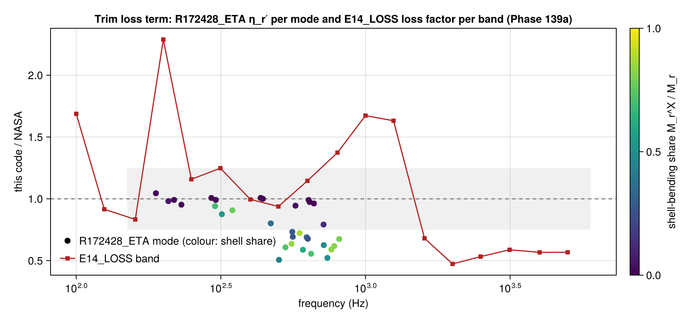

# Phase 139b: does CR-165869 say at which frequency the loss factors are evaluated? (2026-11-10)

Read 2026-11-10 by Claude under the author's delegation of 2026-11-10 (139b′), then one diagnostic run (139b). No criterion, tolerance or shipped default changed.

## What CR-165869 prints (139b′)

| Place | What it says | Does it fix the frequency? |
|---|---|---|
| §3.7, PDF p. 83 | the acoustic loss factor "at frequency ω" is taken from Section 3.1, Eq. (28) | no: ω is not said to be a mode, a tone or a band centre |
| §3.1, Eq. (28), PDF pp. 43–44 | relates the loss factor to the wall conductance | no rule for the frequency |
| Fig. 28 | the computer input is "Averaged Over the Frequency Band" | about the input tables, not about where Eq. (28) or Eq. (82) is evaluated |
| Figs. 35 and 38 | trim transfer coefficient plotted at the 1/3-octave band centres | a plotting grid, not a rule |

So the document does not settle it, and by the 139b′ rule the diagnostic below may run. The diagnostic changes nothing in the code: its result goes in this report, and the runner is removed afterwards.

## The diagnostic (139b)

The hypothesis was fixed on 2026-11-09, before any run. Eq. (82) is evaluated with ω and the trim at the nominal 1/3-octave centre holding each mode, the rule NASA's η_n follows (Phases 95–96). It is supported if at least 24 of R172428_ETA's 32 modes are then within ±25 % of App. B. R172428_ETA's own criterion and its recorded 17/32 do not change. A supported result would be inferred from NASA's printed numbers, not documented, so it could only become a default under the rule of Phase 96, and only by a decision recorded in the plan.

## Result of the run (2026-11-10)

Hypothesis fixed 2026-11-09 (at least 24 of 32 modes within ±25 %): **not supported**, 15 of 32 modes.

| Form of Eq. (82) | Modes within ±25 % of App. B |
|---|---|
| shipped (ω and trim at the mode frequency) | 17 of 32 |
| trim at the band centre, ω at the mode (Phase 102 option, shown only) | 17 of 32 |
| ω and trim at the band centre (the hypothesis) | 15 of 32 |

| Mode | Frequency (Hz) | Band centre (Hz) | NASA App. B η_r′ | this code, hypothesis | shipped − NASA | trim only − NASA | hypothesis − NASA |
|---|---|---|---|---|---|---|---|
| 1 | 188.5 | 200 | 0.08121 | 0.1115 | +4 % | +53 % | +37 % |
| 2 | 208.2 | 200 | 0.1769 | 0.2115 | -2 % | +11 % | +20 % |
| 3 | 217.9 | 200 | 0.01241 | 0.01552 | -1 % | +18 % | +25 % |
| 4 | 231.0 | 250 | 0.02564 | 0.01672 | -5 % | -28 % | -35 % |
| 5 | 293.2 | 315 | 0.00636 | 0.006388 | +1 % | +1 % | +0 % |
| 6 | 301.9 | 315 | 0.2916 | 0.2337 | -6 % | -13 % | -20 % |
| 7 | 303.7 | 315 | 0.00778 | 0.007461 | -1 % | -3 % | -4 % |
| 8 | 318.7 | 315 | 0.1983 | 0.1817 | -12 % | -10 % | -8 % |
| 9 | 346.7 | 315 | 0.1999 | 0.2608 | -9 % | +8 % | +30 % |
| 10 | 434.3 | 400 | 0.00501 | 0.005047 | +1 % | +1 % | +1 % |
| 11 | 441.8 | 400 | 0.00522 | 0.005272 | +0 % | +0 % | +1 % |
| 12 | 470.5 | 500 | 0.03837 | 0.02578 | -20 % | -25 % | -33 % |
| 13 | 502.2 | 500 | 0.05983 | 0.03067 | -49 % | -49 % | -49 % |
| 14 | 528.8 | 500 | 0.06963 | 0.0496 | -39 % | -36 % | -29 % |
| 15 | 555.0 | 500 | 0.06727 | 0.05702 | -36 % | -31 % | -15 % |
| 16 | 558.4 | 500 | 0.02146 | 0.02055 | -27 % | -22 % | -4 % |
| 17 | 560.6 | 500 | 0.0212 | 0.01926 | -31 % | -26 % | -9 % |
| 18 | 572.9 | 630 | 0.0045 | 0.004211 | -6 % | -1 % | -6 % |
| 19 | 591.9 | 630 | 0.05297 | 0.03473 | -28 % | -26 % | -34 % |
| 20 | 607.5 | 630 | 0.04502 | 0.02522 | -41 % | -40 % | -44 % |
| 21 | 626.0 | 630 | 0.0217 | 0.01486 | -31 % | -31 % | -32 % |
| 22 | 632.0 | 630 | 0.01723 | 0.01168 | -32 % | -33 % | -32 % |
| 23 | 636.1 | 630 | 0.00321 | 0.003179 | -1 % | -1 % | -1 % |
| 24 | 641.2 | 630 | 0.00342 | 0.003329 | -3 % | -3 % | -3 % |
| 25 | 648.7 | 630 | 0.05034 | 0.02875 | -44 % | -46 % | -43 % |
| 26 | 663.3 | 630 | 0.00356 | 0.003414 | -4 % | -5 % | -4 % |
| 27 | 716.2 | 800 | 0.00834 | 0.006971 | -21 % | -3 % | -16 % |
| 28 | 717.3 | 800 | 0.03011 | 0.02007 | -37 % | -19 % | -33 % |
| 29 | 738.4 | 800 | 0.03796 | 0.02086 | -48 % | -37 % | -45 % |
| 30 | 761.9 | 800 | 0.05403 | 0.03297 | -41 % | -33 % | -39 % |
| 31 | 779.8 | 800 | 0.05189 | 0.03266 | -38 % | -34 % | -37 % |
| 32 | 811.0 | 800 | 0.04724 | 0.0317 | -33 % | -35 % | -33 % |

## 139a: the ratio curves (2026-11-10)

| Mode | Frequency (Hz) | this code / NASA, η_r′ | shell-bending share |
|---|---|---|---|
| 1 | 188.5 | 1.04 | 0.02 |
| 2 | 208.2 | 0.98 | 0.05 |
| 3 | 217.9 | 0.99 | 0.00 |
| 4 | 231.0 | 0.95 | 0.01 |
| 5 | 293.2 | 1.01 | 0.00 |
| 6 | 301.9 | 0.94 | 0.69 |
| 7 | 303.7 | 0.99 | 0.01 |
| 8 | 318.7 | 0.88 | 0.54 |
| 9 | 346.7 | 0.91 | 0.77 |
| 10 | 434.3 | 1.01 | 0.00 |
| 11 | 441.8 | 1.00 | 0.01 |
| 12 | 470.5 | 0.80 | 0.36 |
| 13 | 502.2 | 0.51 | 0.44 |
| 14 | 528.8 | 0.61 | 0.73 |
| 15 | 555.0 | 0.64 | 0.84 |
| 16 | 558.4 | 0.73 | 0.29 |
| 17 | 560.6 | 0.69 | 0.27 |
| 18 | 572.9 | 0.94 | 0.03 |
| 19 | 591.9 | 0.72 | 0.88 |
| 20 | 607.5 | 0.59 | 0.62 |
| 21 | 626.0 | 0.69 | 0.33 |
| 22 | 632.0 | 0.68 | 0.25 |
| 23 | 636.1 | 0.99 | 0.00 |
| 24 | 641.2 | 0.97 | 0.01 |
| 25 | 648.7 | 0.56 | 0.71 |
| 26 | 663.3 | 0.96 | 0.01 |
| 27 | 716.2 | 0.79 | 0.12 |
| 28 | 717.3 | 0.63 | 0.48 |
| 29 | 738.4 | 0.52 | 0.50 |
| 30 | 761.9 | 0.59 | 0.83 |
| 31 | 779.8 | 0.62 | 0.82 |
| 32 | 811.0 | 0.67 | 0.79 |

| E14_LOSS band (Hz) | this code / NASA |
|---|---|
| 100 | 1.69 |
| 125 | 0.92 |
| 160 | 0.83 |
| 200 | 2.29 |
| 250 | 1.16 |
| 315 | 1.25 |
| 400 | 1.00 |
| 500 | 0.94 |
| 630 | 1.15 |
| 800 | 1.37 |
| 1000 | 1.67 |
| 1250 | 1.63 |
| 1600 | 0.68 |
| 2000 | 0.47 |
| 2500 | 0.53 |
| 3150 | 0.59 |
| 4000 | 0.57 |
| 5000 | 0.57 |

## What the curves show, and 139d

- **R172428_ETA.** The modes whose energy is mostly in the floor have a shell-bending share under 0.2, and they agree within 5 % (modes 1–3, 5, 7, 8, 10, 11, 18, 23, 24, 26). The modes with a shell share of 0.4 or more are 0.5–0.8 times NASA's value. The miss is in the trim term, which acts on the shell. Evaluating that term at the band centre (139b) does not remove it.
- **E14_LOSS.** The pattern differs. This code is 1.1–1.7 times NASA's loss factor at 630–1250 Hz and 0.5–0.7 times above 1600 Hz. That is not the per-mode shortfall of R172428_ETA, so E14_LOSS tells something R172428_ETA does not, and it is kept (ISSUE-029: "keep for now").
- **139d outcome.** The hypothesis is not supported, so no default changes and 139c (the held-out η_r′ of the Merlin list) is not needed. Both cases keep the cause "unexplained (no documented cause survived its test)", now with this run among their tests. R172428_ETA's case record keeps its kind; its "tested in" gains Phase 139.

The runners (`p139a.jl`, `p139b.jl`) were run once from the session scratchpad and are not kept, as the diagnostic rule of 2026-11-10 asks.
