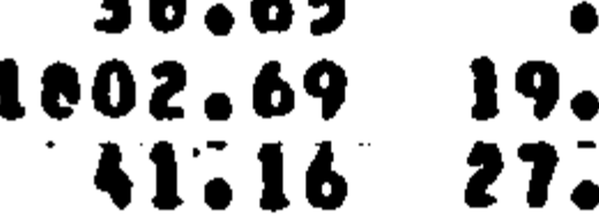

# Phase 142: FLIGHT_MODES on a settled reference file (2026-11-11)

Done by Claude under the author's authority of 2026-11-10 and 2026-11-11 ("finish all open phases"). The criterion of FLIGHT_MODES (fixed 2026-10-30) is unchanged: frequency within 2 % and generalized mass within 10 % for at least 90 % of the listed modes.

## 142a The rule (author, 2026-11-09)

A re-run on a corrected transcription carries the verdict when the correction is made blind against the source page. The first run stays on record as the run on the faulty file.

## 142b Third transcription, blind

- **Source.** CR-172428 App. C pp. 213–216 (`references/Pain Validation.pdf`, PDF pp. 223–226), 221 modes.
- **How.** Each page was rendered at 300 dpi and cut into tiles showing only the mode number, frequency, type, axial order M and total generalized mass. All 221 rows were read from the tiles. The code's output and the two earlier files were not opened until the reading was complete.
- **Compared** cell by cell (884 cells) with the first pass (`appC_merlin_structural_modes.csv`, Phase 101) and the second pass (`appC_merlin_structural_modes_checked.csv`, Phase 110).

| Cell | First pass | Second pass | Third pass | Settled against the page |
|---|---|---|---|---|
| mode 41, total mass | 1002.69 | 1002.69 | 1802.69 | **1802.69** |
| mode 174, total mass | 79.40 | 73.40 | 73.40 | 73.40 |
| mode 230, M | 1 | 4 | 4 | 4 |

Every other cell is the same in all three passes.

**Mode 41**, at 600 dpi: the second digit is the print's filled 8. The 0 beside it is open, with a tall slit.

**What was not blind.** Two things, stated so the reader can weigh them:
- The header of the second-pass file names modes 174 and 230 as corrected cells, and it was read before the tiles. The third pass read both from the tiles and agrees with the second pass.
- Mode 41 was read as 8 from the tile. When it was settled at 600 dpi, this code's value for that mode (1800.91 kg, in the Phase 110 report) was known. The settlement rests on the shape of the digit, shown above.

The verdict does not hinge on mode 41: without it the count is 199 of 221, which is also at least 90 %.

## 142c The re-run (one run, 2026-11-11)

| Run | Reference file | Within the rule | Frequency within 2 % | Verdict |
|---|---|---|---|---|
| first run, 2026-10-30 | first pass (three misreads) | 197 of 221 (89.1 %) | 219 of 221 | not met; stays on record |
| Phase 110, 2026-10-30 | second pass (mode 41 misread) | 199 of 221 (90.0 %) | 220 of 221 | none (post-hoc re-run) |
| **Phase 142, 2026-11-11** | **settled file** | **200 of 221 (90.5 %)** | **220 of 221** | **met** |

The outcome could be told in advance from Phase 110's count. The verdict rests on the reference file being settled against the page, as the rule of 142a asks, not on the count being new.

`FLIGHT_MODES` now reads the settled file. `FLIGHT_MODES_P2` would repeat it and is retired as a case; its outcome is the middle row above and `phase110_flight_modes_pass2.md`. The first-pass file is kept unchanged as the record of the first run, and a test repeats that run on it (197 of 221).

Mode 41 was the example Phase 110 gave for "the in-plane part differs" (1002.69 against 1800.91 kg). It was a misread: the code's 1800.91 kg is within 0.1 % of the printed 1802.69.

## 142d, 142e The 21 modes still outside the rule

One misses in frequency (mode 29). Twenty miss in mass. For those twenty the shell and plate normal-displacement parts agree with NASA's printed SHELL W and PLATE W, so the difference is in the rest (total − shell − plate), the in-plane part.

| Mode | f (Hz) | Type, M | NASA total (kg) | NASA in-plane | This code total | This code in-plane | Frequency | Mass |
|---|---|---|---|---|---|---|---|---|
| 29 | 193.11 | A, 2 | 215.76 | 156.93 | 221.85 | 163.02 | −5.2 % | +2.8 % |
| 101 | 433.59 | S, 2 | 29.82 | 19.81 | 26.79 | 16.78 | 0.0 % | −10.2 % |
| 110 | 461.81 | S, 2 | 16.79 | 5.18 | 19.06 | 7.44 | 0.0 % | +13.5 % |
| 156 | 628.02 | S, 3 | 231.50 | 202.62 | 280.10 | 252.02 | 0.0 % | +21.0 % |
| 164 | 685.10 | S, 2 | 153.10 | 118.47 | 180.64 | 146.15 | 0.0 % | +18.0 % |
| 165 | 685.92 | S, 2 | 270.97 | 241.75 | 239.80 | 211.00 | 0.0 % | −11.5 % |
| 166 | 695.53 | S, 3 | 97.63 | 60.18 | 108.08 | 70.74 | 0.0 % | +10.7 % |
| 168 | 706.20 | S, 4 | 86.87 | 43.82 | 73.18 | 30.21 | 0.0 % | −15.8 % |
| 187 | 761.24 | S, 4 | 72.59 | 7.40 | 99.25 | 34.01 | 0.0 % | +36.7 % |
| 194 | 780.19 | S, 4 | 72.14 | 52.98 | 79.45 | 60.42 | 0.0 % | +10.1 % |
| 204 | 837.70 | S, 2 | 37.45 | 9.35 | 32.70 | 5.61 | 0.0 % | −12.7 % |
| 205 | 849.45 | A, 3 | 192.22 | 164.96 | 155.80 | 131.01 | 0.0 % | −18.9 % |
| 208 | 870.27 | S, 5 | 43.34 | 9.06 | 48.83 | 15.18 | 0.0 % | +12.7 % |
| 209 | 870.58 | S, 3 | 53.99 | 21.48 | 38.52 | 7.69 | 0.0 % | −28.7 % |
| 212 | 885.75 | S, 4 | 33.21 | 2.44 | 45.24 | 14.46 | 0.0 % | +36.2 % |
| 220 | 905.80 | A, 4 | 26.20 | 10.78 | 20.29 | 5.56 | 0.0 % | −22.6 % |
| 223 | 912.66 | S, 4 | 67.01 | 34.30 | 33.73 | 2.70 | 0.0 % | −49.7 % |
| 225 | 916.29 | S, 5 | 71.36 | 10.21 | 152.03 | 92.09 | 0.0 % | +113.1 % |
| 227 | 922.55 | A, 5 | 21.80 | 4.59 | 19.50 | 2.86 | 0.0 % | −10.5 % |
| 233 | 947.66 | S, 6 | 40.36 | 3.89 | 46.24 | 10.17 | 0.0 % | +14.6 % |
| 234 | 952.25 | S, 5 | 77.09 | 22.72 | 57.30 | 4.48 | 0.0 % | −25.7 % |

What the table shows:
- **Both signs.** The in-plane part is too large in 10 modes and too small in 10. A term missing from the generalized mass would push every mode the same way, so the table does not point at one missing term.
- **Where.** 17 of the 20 are symmetric modes, and 17 lie above 680 Hz.
- **Pairing (142e).** For each of the 21, the second-nearest solver mode of the same symmetry and M was checked. Two (modes 164 and 165, 0.8 Hz apart) have a second candidate within 0.5 % in frequency. Swapping does not help: the other partner's mass is 57 % and 33 % off. So the pairing rule is not the cause.

**Not done in this phase.** The term-by-term check of the floor's in-plane terms, Eqs. (D.17)–(D.29), against `mrp_appd.jl`, and the comparison with Peterson and Boyd (1978), which is not in the repository. No term was found, so no unit test was added and no source line changed. The case is met, so this no longer stands between the case and its rule. It is ISSUE-039.

The runner of this table was a one-off script, run once and not kept (rule of 2026-11-10).

## Follow-up 2026-11-12 (ISSUE-039)

The generalized-mass terms are the ones `MRP_APPD` checks against Table D-1 (median 0.11 %), so the twenty are not a missing term. They sit closer to a same-type printed neighbour than the passing modes do (median 4.0 % against 8.7 %). For 9 of them the pair's summed mass matches NASA's within 8 %: the two programs split a near pair's mass differently. The other 11 are not explained by the documents. Nothing in the code changed.
