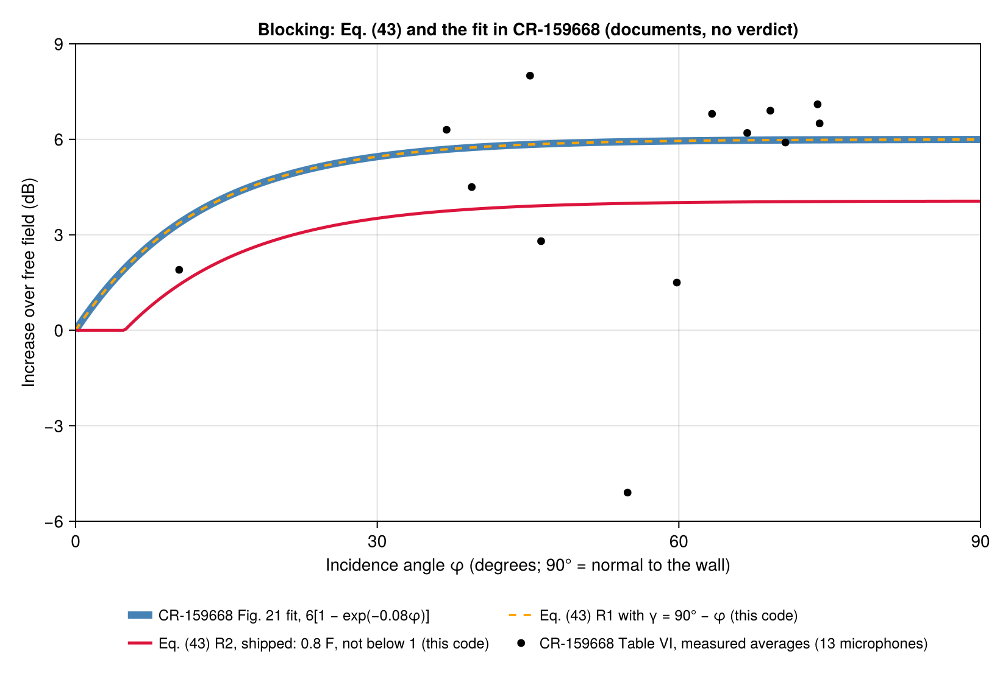

# Phase 144: blocking R2, and where Eq. (43) comes from (2026-11-11)

Done by Claude under the author's authority of 2026-11-10 and 2026-11-11. No case, criterion, tolerance, reference file or recorded result changed in this phase. 144a–d were done on 2026-11-10 (`phase135_151_decisions.md`); this report adds 144e.

## 144a–d (2026-11-10)

| Step | Outcome |
|---|---|
| 144a R2 on flight run 10's printed field | No case: the deck's 11 cards lie at three points, and Phase 104 already compared the six H2–H4 cards at two of them. It stays a unit test. |
| 144b Fig. 10 | The R2 rows are on `R996_FIG10_FLAT`, shown but not judged, with the note that their numbers were on record (4.03–4.06 dB). `R996_FIG10_CIRC` is information. |
| 144c Text | "Radius not stated" became "Eq. (43) has no curvature term". METHODOLOGY says why R2 is the default (CR-172428 §5.3.2; Phase 93). |
| 144d `BLK_P68` | Off the coverage chart; a unit check of Eq. (43). |

## 144e Eq. (43) against the fit in CR-159668

NASA CR-159668 (Magliozzi and Brooks, 1979) prints its curve on Fig. 21 (PDF p. 57) as

ΔdB = 6 [1 − exp(−0.08 φ)],  φ = incidence angle, 90° = normal to the wall.

Eq. (43) of CR-3813 is F(γ) = 10^(0.3 − 0.000224 e^(0.08 γ)), with γ = 0° normal to the wall. In dB that is 6 − 0.00448 e^(0.08 γ). Put γ = 90° − φ:

- 6 e^(−0.08·90) / 20 = 0.0002240, the printed 0.000224.
- 20 × 0.3 = 6, the fit's 6 dB.

So **Eq. (43) is CR-159668's fit, rewritten for the angle from the normal.** The two curves differ by at most 0.0006 dB over 0–90° (the rounding of 0.000224). The code's R1 curve lies on the fit within the same 0.0006 dB.

What the figure shows (documents against documents, no verdict):

- **R1 is the fit.** The dashed line sits on the thick one.
- **R2 is not from this report.** R2 (0.8 F, not below 1) peaks at 4.06 dB. The six Table VI points beyond φ = 60° read 5.9–7.1 dB, and the report reads them as the full 6 dB. Nothing in CR-159668 supports a 4 dB maximum, so R2 rests on CR-172428 §5.3.2 alone, as METHODOLOGY says.
- **The scatter is as large as the effect.** Table VI's 13 averages run from −5.1 to 8.0 dB. That is why no case is built on them (ISSUE-006, read 2026-11-09).

**A note on the source.** Read by eye, Fig. 21 shows 14 points, while Table VI has 13 averages. One drawn point (about 76°, 8.2 dB) has no row in the table, and microphone 1 (70.6°, 5.9 dB) seems to be drawn near 60°. The figure above plots the table. This does not change the fit, which is printed on the figure.

The figure was drawn by a one-off script that calls `PAIN.delta_L_blocking_dB` for R1 and R2. It was run once and not kept (rule of 2026-11-10).
