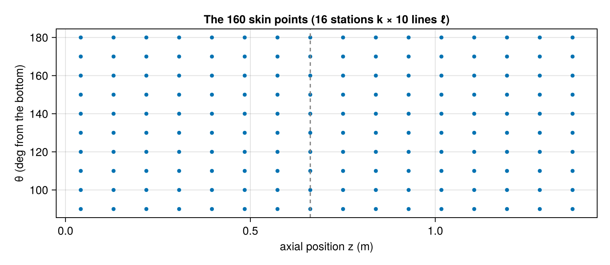
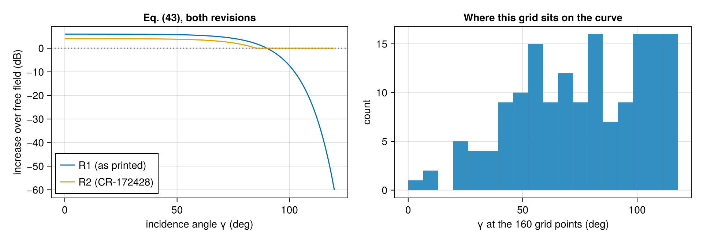
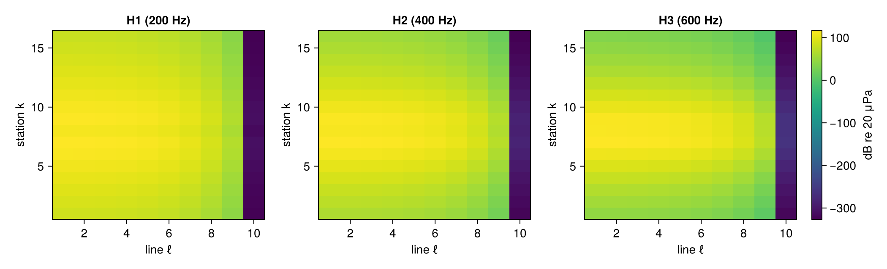
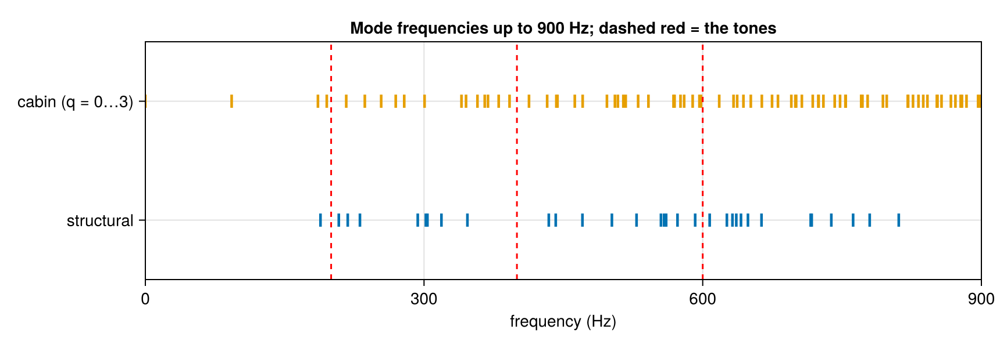
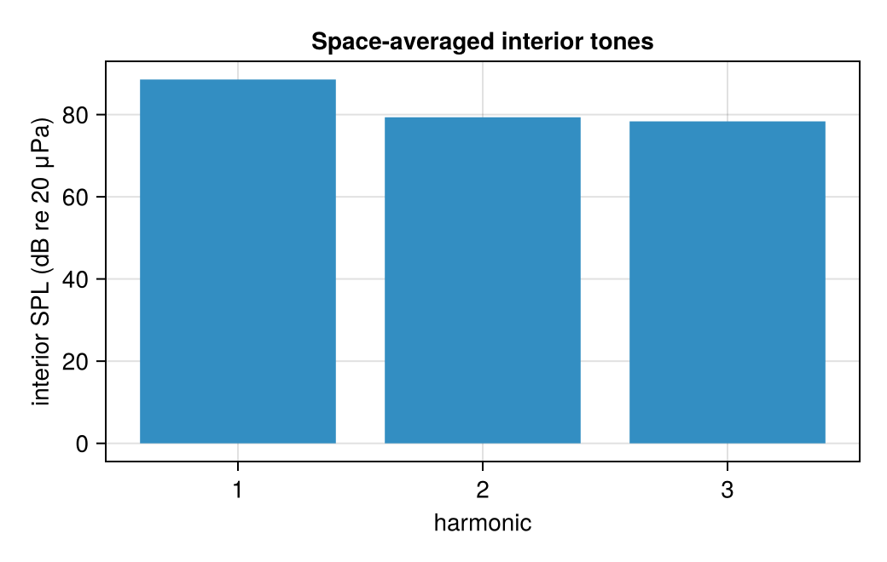

# Walk-through: the program, and how to read a validation case

*Generated 2026-10-30 by `PAIN.jl/scripts/run/write_walkthrough.jl`. Display only: every number below is what the
code produces on the inputs named here, with no criterion attached. The checks that do carry a criterion are the
registered cases of [`VALIDATION_GUIDELINE.md`](VALIDATION_GUIDELINE.md) §2.13.*

This page replaces the two Pluto notebooks of Phase 91 (retired 2026-10-30). It walks the pipeline stage by stage on
NASA's fuselage test article — the article CR-3813 App. E and CR-172428 describe — and then reads one registered case
end to end. To change an input and watch the stages move, use the GUI (`scripts/run_gui.jl`), which runs the same
functions; to change them in a script, copy the call in part 1 below.

## Part 1 — the program, stage by stage

The source here is ANOPP's printed free field (CR-3813 Table 8), the input of validation case `REPRO_18b`; the user
source is BEMT + F1A ([`METHODOLOGY.md`](METHODOLOGY.md) §2.3). The run:

```julia
trim = phase3_trim(; η_lining = 0.5)
res  = run_pain_pipeline(; source = :e11, e11_amp_csv = PAIN.default_e11_paths().anopp_spl,
                           n_harmonics = 3, bpf_Hz = 200.0, blocking = R1,
                           sidewall_trim_stack = trim.sidewall, end_trim_stack = trim.ends, mech = trim.mech)
```

`bpf_Hz` is the blade-passage frequency (200 Hz for the test article at 4000 rpm with 3 blades). `blocking`
is `R1`, Eq. (43) as printed, or `R2`, CR-172428's revision (0.8 × R1, never below free field). `η_T` is the trim's
loss factor (Phase III trim; 0.5 is NASA's value for E-16). This run gives
160 grid points, 32 structural modes and
20 cabin cross-section modes.

### 1.1 The grid (User Manual Fig. 3)

PAIN samples the exterior pressure at 160 points on the upper quarter of the fuselage near the propeller: 16 axial
stations k by 10 circumferential lines ℓ. `z` is the axial position, θ the angle from the bottom of the fuselage; the
dashed line is the propeller plane.



### 1.2 Blocking, Eq. (43)

The fuselage reflects the incoming sound, so the pressure on the skin is higher than in free space. PAIN multiplies the
free-field amplitude by F(γ) = 10^(0.3 − 0.000224 e^(0.08γ)), with γ the angle between the line from the propeller hub
and the skin normal (CR-3813 p. 31). At normal incidence F = 2 (+6 dB); at γ = 90° F = 1. The right panel shows where
this grid's 160 points fall on that curve: γ runs from 0.0° to 117.8° here, and
64 of the 160 points sit past 90°, where the printed Eq. (43) keeps falling and so attenuates
rather than reflects. The code applies the equation as printed, with no clamp at 90°; R2 alone is floored at F = 1.



### 1.3 Blocked pressure on the grid

What PAIN hands to the cabin chain: the free field times F(γ), in dB re 20 μPa (rms). One panel per harmonic; rows are
axial stations, columns circumferential lines.



### 1.4 Modes

**Structural modes** come from NASA's Table D-1 (MRP's output for the test article, CR-3813 App. D): frequency,
generalized mass M_r, and the number of axial half-waves M. **Cabin modes** come from CYL2D (App. C): each
cross-section mode i combined with q axial half-waves, f² = f_i² + (q c₀ / 2L_c)². The first twelve structural modes:

| structural mode | f (Hz) | M_r (kg) | M |
|---|---|---|---|
| 1 | 188.5 | 1.139 | 1 |
| 2 | 208.2 | 1.126 | 1 |
| 3 | 217.9 | 1.062 | 2 |
| 4 | 231.0 | 1.054 | 2 |
| 5 | 293.2 | 1.055 | 3 |
| 6 | 301.9 | 3.356 | 1 |
| 7 | 303.7 | 1.040 | 3 |
| 8 | 318.7 | 5.336 | 1 |
| 9 | 346.7 | 3.076 | 1 |
| 10 | 434.3 | 1.053 | 4 |
| 11 | 441.8 | 1.033 | 4 |
| 12 | 470.5 | 2.275 | 2 |



A tone that lands near a structural *and* a cabin mode that couple well is transmitted strongly; that is what Eq. (8)
sums.

### 1.5 Tones inside the cabin, Eq. (8)

Eq. (8) sums, over every structural mode r and cabin mode n, the power the skin's mode r feeds into the cabin's mode n:
the generalized force of the blocked pressure on mode r (Eq. 42), the coupling f′(n, r) between the two shapes
(Eq. 52), and both modes' resonance and damping. The result is the space-averaged mean-square pressure in the cabin.



Interior tones from this run: H1 88.6 dB, H2 79.4 dB, H3 78.4 dB. NASA's printed prediction for the same case (Fig. E-16) is 79.0, 75.5,
68.0 dB. The difference is not a verdict — `REPRO_18b` is the registered case that compares the two against a criterion
fixed on 2026-10-20, and `VALIDATION_GUIDELINE.md` §2.14 says where the remaining gap is attributed.

### 1.6 Things to try

* `blocking = R2` instead of `R1`: R2 is 0.8 × R1 and never below free field, so every blocked level drops and the
  tones follow.
* `η_lining = 1.0` (the trim of Fig. E-18's case): the trim absorbs more, so the higher harmonics fall while H1,
  controlled by a different mode pair, can rise.
* A different `n_harmonics` or `bpf_Hz`: the tone lines in §1.4 move across the mode set, which is what makes a tone
  loud or quiet.

## Part 2 — reading a validation case

Every check of this recreation is a registered *case*: fixed inputs, a reference, and a criterion written down, with
its date, before the case was first run.

**What carries a verdict.** A case may be *met* or *not met* only if it compares with an experiment (E), or checks
that the code does exactly what PAIN did on PAIN's own inputs (P) (rule of 2026-10-29, `CLAUDE.md`). Everything else —
hand checks, identities, other methods, diagnostics — runs and is recorded but carries no verdict. The validation map
shows only the cases with a verdict; the rest are in [`NO_VERDICT_CASES.md`](NO_VERDICT_CASES.md).

From the recorded snapshot: **134** registered cases;
**48** on the map (12 met, 36 not met);
86 without a verdict.

### 2.1 Run one

`R172428_CODE` runs NASA's own inputs for the test article (CR-172428 App. B) and compares with what NASA's program
printed — a P case.

```julia
case   = VALIDATION_CASES["R172428_CODE"]
result = run_validation_case("R172428_CODE")
```

**CR-172428 reproduction: NASA's inputs vs NASA's printed predictions (44d)**

*Criterion (2026-10-23):* Within ±3 dB of NASA's printed prediction at ≥ 7 of 9 points (3000/4000/5000 rpm, H1–H3).

*Verdict:* **not met** — 4/9 within ±3.0 dB; H1–H3 = 3000:H1 71.07, 3000:H2 69.02, 3000:H3 62.66, 4000:H1 102.45, 4000:H2 80.05, 4000:H3 71.69, 5000:H1 90.35, 5000:H2 94.4, 5000:H3 78.4

### 2.2 Its table

One row per compared point: the reference value, this code's value, the difference, and whether it is within the
criterion.

| point | reference | this code | difference | within |
|---|---|---|---|---|
| 3000 rpm H1 | 63.3 | 71.07 | +7.77 | no |
| 3000 rpm H2 | 66.2 | 69.02 | +2.82 | yes |
| 3000 rpm H3 | 59.5 | 62.66 | +3.16 | no |
| 4000 rpm H1 | 91.69 | 102.5 | +10.8 | no |
| 4000 rpm H2 | 78.19 | 80.05 | +1.86 | yes |
| 4000 rpm H3 | 71.3 | 71.69 | +0.394 | yes |
| 5000 rpm H1 | 86.4 | 90.35 | +3.95 | no |
| 5000 rpm H2 | 91.1 | 94.4 | +3.3 | no |
| 5000 rpm H3 | 75.7 | 78.4 | +2.7 | yes |

The same case's recorded figure, and every other case's, is in the **Validation cases** section of the website
(`site/build_site.jl`), and on disk under `docs/validation_reports/figures/`.

### 2.3 A diagnostic

A diagnostic re-runs a case with one thing changed, to test a possible cause of its miss. It carries no verdict, but
its outcome is kept: `underlying_verdict` returns it. `R172428_CODE_ETAN` re-runs `R172428_CODE` with each cabin mode's
loss factor taken per mode (Phase 89). Diagnostics are listed, with what each one refuted, in
[`NO_VERDICT_CASES.md`](NO_VERDICT_CASES.md).

### 2.4 Where to read more

* [`VALIDATION_GUIDELINE.md`](VALIDATION_GUIDELINE.md) §2.13 — the record of every case: what it tests, why, and its
  recorded outcome.
* [`VALIDATION_GUIDELINE.md`](VALIDATION_GUIDELINE.md) §2.14 — why each not-met case misses (classes M, A, I, N, D).
* [`COMPLETED_PHASES.md`](COMPLETED_PHASES.md) — how each check was planned, with its criteria dated before the run.
