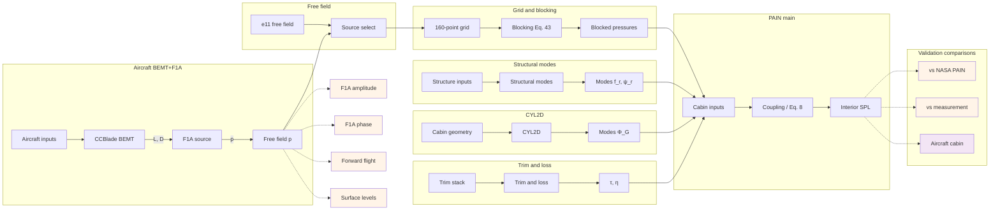
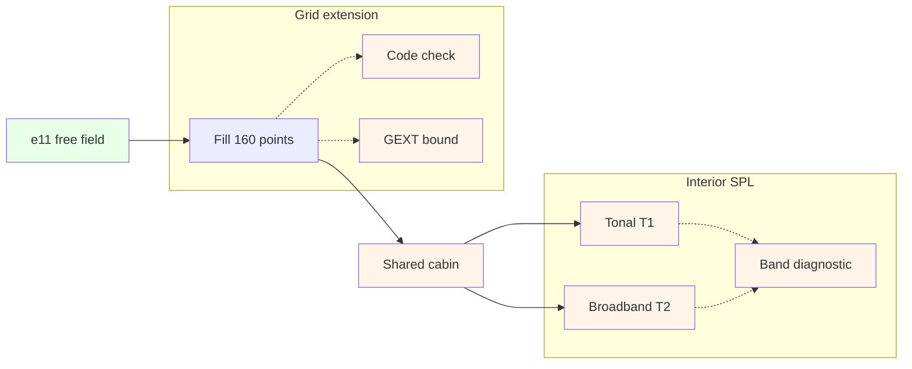
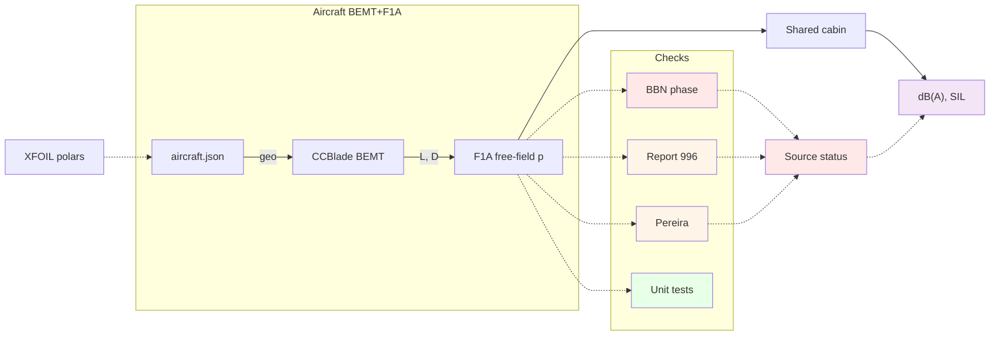
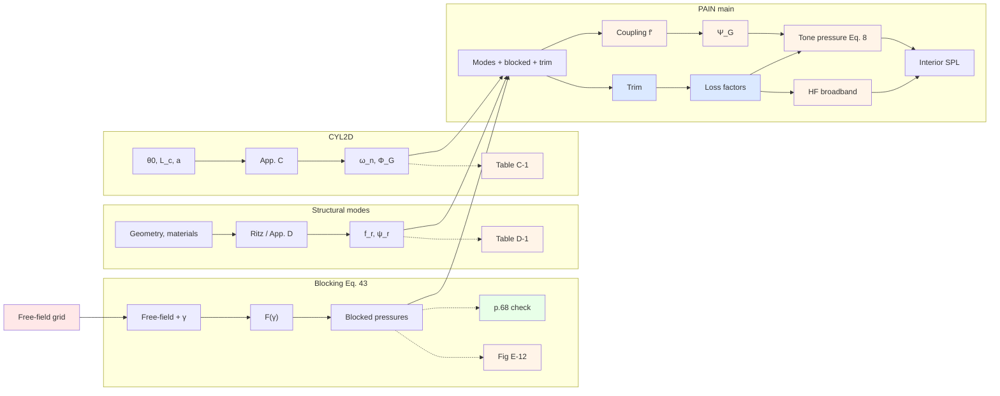
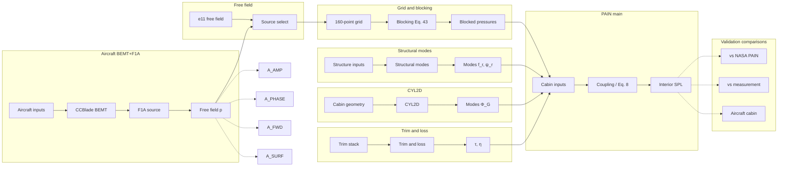

# PAIN recreation flowcharts

| Diagram | What it shows |
|---------|---------------|
| [1. Overview](#1-overview) | Total flowchart: aircraft + e11 → grid → cabin → checks |
| [2. NASA validation (e11)](#2-nasa-validation-e11) | Measured free-field → GEXT → cabin → T1/T2 |
| [3. Aircraft validation](#3-aircraft-validation) | BEMT+F1A source and experiment checks |
| [4. Shared cabin model](#4-shared-cabin-model) | Blocking, modes, trim, PAIN main |
| [5. Validation maps](#5-validation-maps) | GUI `total` map (titles only) |

Colour key in diagrams: green = check exists and passes as stated; orange = planned / differs / calibrated; blue = calibrated surrogate; red = blocked / fail. **Status and evidence live in the tables under each diagram**, not inside nodes. Detail: `IMPLEMENTATION_PLAN.md`.

## Status

- **2026-10-23:** Phases 50–58 closed (`NR_PROP_TP2444_PF` on P_MEAS; `sparse_guard`, Ritz `include_floor`/`include_stiffeners` options; Q22 closed). Phase 48 (P_FF / P_MEAS): `BPM_RP1218` met; `PROP_BB_FIG14`, `PROP_BB_FIG17`, `T2_PRED_BB` not met. Phase 49 (P_EQ8 / trim): Eq. (20) sums the modes below the band, as printed; no in-theory input correction for T2's high-frequency gap (NASA: the trim model is valid to about 1 kHz). Phase 47 (P_MEAS): `NR_PROP_TP2444` not met 1/7, `T2_MEAS_EXT` not met (21.3 vs 51.0 dB). The measured TP-2444 exterior through T2's cabin path shows that PAIN's high-frequency noise reduction is 15–27 dB too high for the trimmed article; NASA's own E-21/E-22 predictions show the same. Phase 46: isolated checks for the last untested T1/T2 functions (37/37). Phase 45 `NR_TP1964_XOVER` (T2's Eq. 19 path on TP-1964; P_MEAS). Phase 44f: Eq. (52) floor-term sign of NASA's corrected program (P_EQ8 coupling); T1_F1A_FILL met post-hoc. Phase 42 `LOUDEST_PT` (output stage: loudest-point dB(A) next to the space average). Phase 44 CR-172428 reproduction (`R172428_CODE`, `R172428_EXP`, `R172428_ETA`, `R172428_TRIM`, `R172428_PAIRS`): NASA's printed App. B field and Table 6 inputs through the cabin chain; App. A η_r′ option; Eq. (83) now uses the bare f′. Phase 43 T1/T2 root causes (`T1_MEAS_DAMPING`, `H3_ATTRIB`, `NR_TP1964` / `_REF2`, `T1_F1A_FILL`, `T1_F1A_MEAS_DAMP`); card-10 volume crossover default; bare-cylinder module `circular_cavity.jl`. Phase 41 isolation chips (`T1_FROM_E12`, `TRIM_CLOSED`, `NR_BAND_HAND`, `HF_MASSLAW`, `BEMT_HAND`, `F1A_INDEP`); five met, `T1_FROM_E12` not met (cabin chain). Phase 40 `ISO_*` all met except 40f. See `VALIDATION_GUIDELINE.md` §2.13.
- **2026-10-22:** GUI Validation map is one horizontal `total` flowchart (aircraft + e11 + cabin + checks); titles only on blocks; stage frames pairwise disjoint (aircraft checks above/below pipeline). See §5 and `VALIDATION_GUIDELINE.md` §2.13.
- **Phases 38d–38e / 38c / 38h / 38g / 36:** E18_TONES, E15_STRUCT_LOSS, HF broadband, printed outputs, MRP_APPD, cabin mode animation — see `IMPLEMENTATION_PLAN.md`.
- **L = 1.83 m (I-22, post-hoc):** `test_article_length()` default; re-records in `length_rerecord_before_after.md`; no verdict flips.
- **Grid azimuth (12b):** ℓ = 1 at propeller azimuth; pre-2026-10-20 e11 results void.
- **Test tooling (P1):** `Pkg.test` `test_args` substrings; DaemonMode optional under `scripts/devtools/`. Tests write only to a temp dir; a final check fails if the suite modifies tracked docs/data (2026-10-23).
- **Layout (R1):** CR-3813 data under `data/cr3813/`; scripts under `PAIN.jl/scripts/{run,checks,digitize,setup,smoke}/`.

## 1. Overview

Whole program (titles only). Same structure as the GUI `total` map.

| Block | Status / evidence | Where |
|-------|-------------------|-------|
| Aircraft BEMT+F1A | Source path; X-EXTRAP for cabin | Diagram 3; map `G_AIR` |
| e11 free field | Digitization QA; ANOPP H3/phases | E11_FREEFIELD |
| Grid + blocking | Unit + Eq. 43 checks | UT_GRID, BLK_P68, E12_BLOCK |
| Structural / CYL2D / trim | Table D-1 / C-1 / App. A | MRP_*, CYL2D_C1, UT_TRIM, E14/E15 |
| PAIN main | Eq. 8 + HF | UT_EQ8; 38b–38c |
| vs NASA PAIN / measurement | Code-on-code / in-sample | REPRO_18b, E18_TONES, T1, T2, E21_E22_NR |
| Aircraft cabin | X-EXTRAP | A_CABIN |

## 2. NASA validation (e11)

Purpose: cabin model vs NASA published results. No CCBlade/F1A.

| Block | Status / evidence | Where |
|-------|-------------------|-------|
| e11 free field | δ_dig ≤ 1 dB | E11_FREEFIELD; `e11_delta_dig.md` |
| Fill 160 points | V-ASSUMED GEXT | `grid_extension.jl` |
| Code check | Grid formulas | UT_GRID |
| GEXT bound | Variants flip T1 → not claimable | GEXT_BOUND; phase 32 |
| Shared cabin | Untuned CR-3813 chain | Diagram 4 |
| Tonal T1 | Calibrated / GEXT-bound | T1; REPRO_18b; E18_TONES |
| Broadband T2 | Surrogate + Eq. 19 | T2; T2_EQ19; E21_E22_NR; E15 |
| Band diagnostic | E-7 bands | (diagnostic) |
| Fig E-12 | 29/31 within 3.41 dB | E12_BLOCK; `e12_blocking.md` |

## 3. Aircraft validation

Purpose: free-field source vs BBN, Report 996, Pereira. Cabin result is extrapolation.

| Block | Status / evidence | Where |
|-------|-------------------|-------|
| Polars | Viterna fixed pre-comparison; truncated entries regenerated 2026-10-22; display of curves + measured overlay + coverage (`POLAR_R996` panel 4: one colour per α) | UT_POLAR, POLAR_R996, POLAR_PER |
| CCBlade BEMT | T, Q / C_T, C_P | R996_LOADS, PER_LOADS |
| F1A free-field p | Shared `evaluate_propeller_source` | `propeller_ccblade.jl` |
| BBN phase | Common time base; I-19 pair φ_b−φ_a (post-hoc) | BBN_KIN, BBN_CIRC, BBN_LONG |
| Report 996 | Amplitude matrix; A_rms convention | R996_FIG*; F1A_GUTIN |
| Pereira | Forward flight | PER_FIG6–9 |
| Unit tests | V-CODE | F1A_GUTIN, BBN_KIN |
| Shared cabin / dB(A) | X-EXTRAP | A_CABIN; Run tab |
| Open author | I-17 amplitude | `VALIDATION_GUIDELINE.md` |
| Aircraft cabin guard / tags | 29b/29c done 2026-10-22 | `aircraft_provenance.jl`; §2.10 guard column |
| Parametric cabin blocks | 30a–30d done 2026-10-22 | `cabin_blocks=:parametric` (aircraft default); App. D + Eq.19; `parametric_regression.md` |
| Uncertainty (epistemic band) | 31a–31f done 2026-10-22 | `UNC_COVER` `:not_met` (H2/H3); aircraft H1–H3 band; after I-19 k≈0.09, phase (i) does not dominate; not a CI |

## 4. Shared cabin model

Both paths feed the same blocks (IN → FUNC → OUT → VERIFY).

| Block | Status / evidence | Where |
|-------|-------------------|-------|
| Free-field grid | Upper quarter; ℓ = 1 at φ_p | UT_GRID; 12b |
| Blocking F(γ) | ≤ 0.06 dB on p.68 | BLK_P68 |
| Fig E-12 | 29/31; 2 H3 aft fail | E12_BLOCK |
| Structural modes | D-1 seed; Ritz calibrated; App. D 27/32 | MRP_D1, MRP_RITZ, MRP_APPD |
| CYL2D | Ratios / Φ_G / symmetry | CYL2D_C1 |
| Trim / loss | App. A; E-14 / E-15 | UT_TRIM, E14_LOSS, E15_STRUCT_LOSS |
| Coupling / Ψ_G / Eq. 8 | Default tone path | UT_EQ8; 17a–17f |
| HF broadband | Surrogate default; Eq. 19 | 38b–38c; T2_EQ19 |
| SRC_TA amplitude | I-17 open (√2) | `VALIDATION_GUIDELINE.md` §2.1 |

## 5. Validation maps

GUI tab **Validation map** shows one map `total` (`src/validation_map.jl`), laid out from §2.13 `Position` / `Feeds` / `Group` / `Role`. Stage frames bound each group's own blocks only (positions chosen so frames are pairwise disjoint; aircraft checks above/below the pipeline). Titles only on boxes; case chips keep verdict dots and a short display-only error line plus source date (`case_error_summary`: `k/n · X U max` / `no verdict · X U max`; paren units; `:none` coverage text when met/not_met). Horizontal + vertical scroll; zoom / fit.

| Block | Status / evidence | Where |
|-------|-------------------|-------|
| All P_* / A_* cases | Unchanged ids, verdicts, criteria | `VALIDATION_GUIDELINE.md` §2.13 |
| New X_* connectors | Layout only; no cases | Map `total` |
| UT_GRID figure | Sample-index error panel | `docs/validation_reports/figures/UT_GRID.png` |
| Screenshot | Offscreen smoke, zoom 1, left + right | `VALIDATION_MAP_TOTAL.png`, `VALIDATION_MAP_TOTAL_right.png` |
