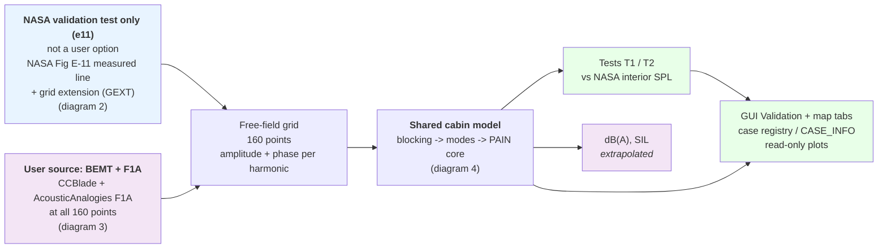
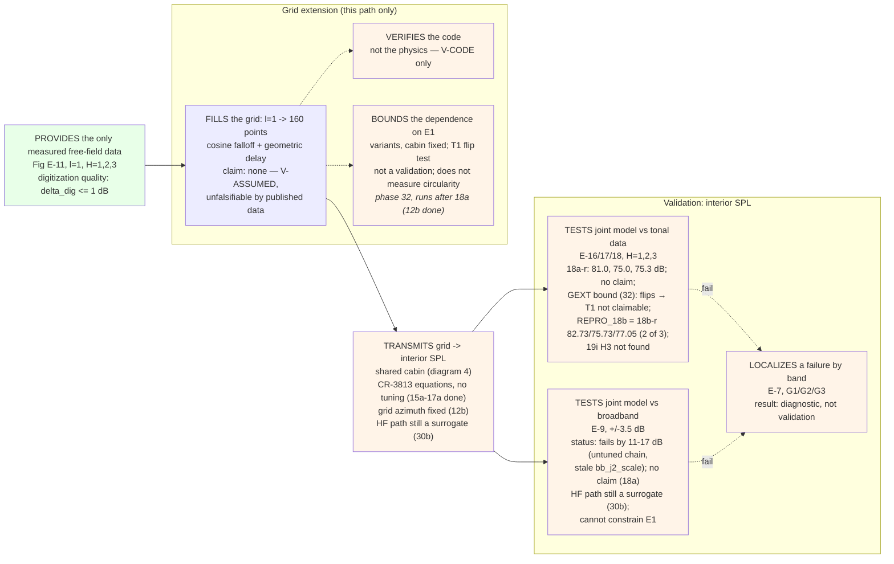
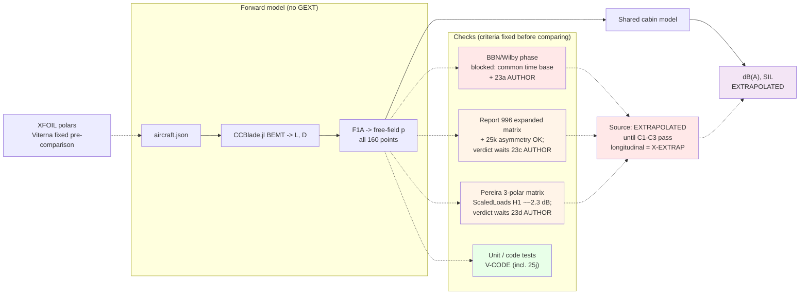
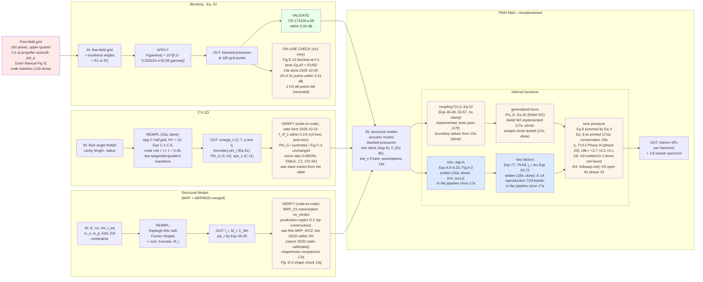
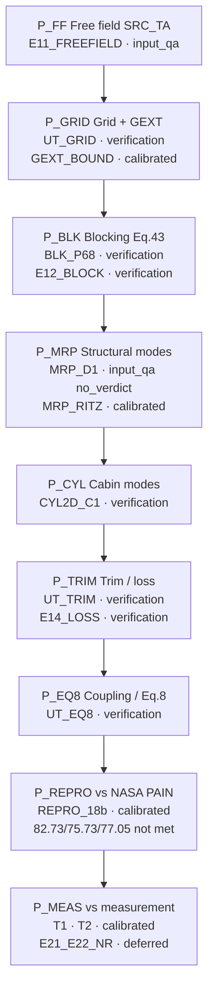
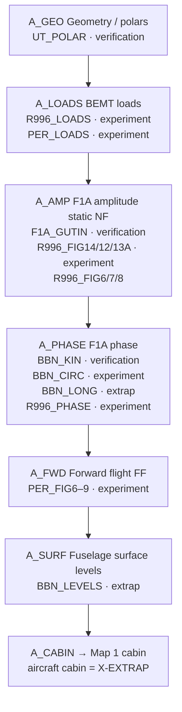

# PAIN recreation flowcharts

The user source is BEMT + F1A, which gives the free-field pressure at the 160 fuselage grid points. NASA's measured data are a validation test of the cabin model only, not a user option. The cabin stages are the same for both.

| Diagram | What it shows |
|---------|---------------|
| [1. Overview](#1-overview) | The user source (BEMT + F1A), the NASA validation test, and the shared cabin model |
| [2. NASA validation (e11)](#2-nasa-validation-e11) | NASA measured data -> grid extension -> cabin model -> tests T1/T2 |
| [3. Aircraft validation](#3-aircraft-validation) | CCBlade + F1A source, XFOIL polars, and the BBN/Wilby, Report 996 and Pereira checks |
| [4. Shared cabin model](#4-shared-cabin-model) | Blocking, structural modes, acoustic modes, PAIN core |
| [5. Validation maps](#5-validation-maps) | Map 1 cabin-chain cases; Map 2 aircraft-source cases (GUI "Validation map" tab) |

Grid extension (GEXT) appears only in diagram 2. It exists because the NASA paper measured one line of the grid.

Status key: green = check exists and passes as stated; orange = planned, not independently checked, or the current code differs from CR-3813; blue = calibrated surrogate. Step numbers refer to `IMPLEMENTATION_PLAN.md`. **2026-10-21:** phases 32–35 done. Source checks reported; GEXT flips → T1 not claimable; GUI Run tab = aircraft only; **Validation** + **Validation map** tabs → case registry / CASE_INFO → CairoMakie plots with error panels (`docs/validation_reports/figures/`). Greyed only E21_E22_NR / R996_FIG8. `REPRO_18b` = 18b-r inputs (82.73/75.73/77.05, not met); `MRP_D1` = transcription `no_verdict`; CYL2D = ratio form. Open: free-field amplitude convention (I-17). Aircraft path stays X-EXTRAP; 29b–31 deferred (B-4).

**Grid azimuth (12b, done 2026-10-20).** The 160-point grid lies on the upper quarter of the fuselage with line ℓ = 1 at the propeller azimuth φ_p, θ_ℓ = φ_p + (ℓ−1)π/18 (User Manual p. 34 and Fig. 3), and γ is the angle between the surface→hub direction and the outward normal (γ = 0 at ℓ = 1, k = k_p). Before the fix the code put ℓ = 1 at the bottom centerline, so e11 results computed before 2026-10-20 used the wrong incidence angle and the wrong shell region and are void. Results in diagram 2 now come from the corrected grid but now use the untuned CR-3813 cabin chain (Eq. 8, App. A trim, §3.8 losses; 17a, 2026-10-20), regraded in 18a. Order of work: `IMPLEMENTATION_PLAN.md`, phases numbered in run order (12 grid fix, 13 pre-registration and 14 E-12 check, done; 15–18 cabin chain, 19–27 source checks, 28–30 aircraft cabin, 31 GEXT bound, 32 close-out).

## 1. Overview

## 2. NASA validation (e11)

Purpose: check the cabin model against NASA's published results. The source is NASA's measured free-field data, so no
CCBlade or F1A is involved.

Note: the Fig E-12 check (blocked pressure on the l=1 line) belongs to blocking; see diagram 4. 14a is done (2026-10-20): Eq. 43 reproduces NASA's predicted E-12 curve at 29 of 31 points within delta_dig + 0.5 dB, FAIL at 2 H3 points aft, recorded (`e12_blocking.md`).

## 3. Aircraft validation

Purpose: compute the free-field source for your own propeller and aircraft (CCBlade + F1A) and check it against
BBN/Wilby, NACA Report 996 and Pereira. No NASA cabin measurement is involved, so the cabin result is an extrapolation.

Order of the checks (decision 2026-10-16): BBN/Wilby first for phase; Report 996 for amplitude; Pereira second as the
forward-flight check. Pass criteria are written before any comparison; no tuning to delta 0. Fuselage scattering and
reflection stay V-ASSUMED.

Code status (2026-10-21 phases 33–35): 21–28 and 32–35 done (29b–31 deferred); GUI source = aircraft only; Validation map tab live. GEXT remains e11-only (diagram 2). Open author item: I-17 amplitude convention.

**Blocked for author:** I-17 [AUTHOR] free-field amplitude (rms vs Fourier peak); 29b/29c [CONFIRM].

Design rule: the CCBlade -> F1A -> FFT step is one function, `evaluate_propeller_source`. The 160-point grid,
the Report 996 checks, and the Pereira check all call it with different observer lists; the Table-8 calibration is a separate
post-step and is never applied inside it. Nothing else may reimplement that step.

## 4. Shared cabin model

Both paths feed the same blocks.

**SRC_TA note (I-17, open 2026-10-21):** free-field SPL→Pa for the e11 / Table-8 path may omit the Fourier-peak √2 relative to CR-3813 / User Manual amplitude A. Author decision pending; see `VALIDATION_GUIDELINE.md` §2.1.

## 5. Validation maps

GUI tab **"Validation map"** (`src/validation_map.jl`). Cases are read-only; page images are display-only; numbers come from CSVs or transcribed tables.

### Map 1 — PAIN verification (CR-3813 cabin chain)

Verifies the cabin chain against its own printed equations, tables and NASA PAIN output, then in-sample against measurement. Does **not** cover the aircraft source.

### Map 2 — Aircraft source (CCBlade BEMT + F1A)

Verifies the aircraft free-field source against experiments it was not tuned to. Report 996 = static near-field amplitude; BBN = phase on a fuselage; Pereira = forward flight far field. Aircraft cabin SPL stays **X-EXTRAP**. Does **not** claim a validated aircraft cabin.

